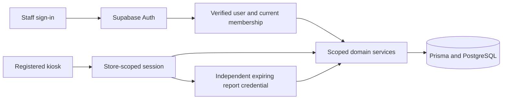
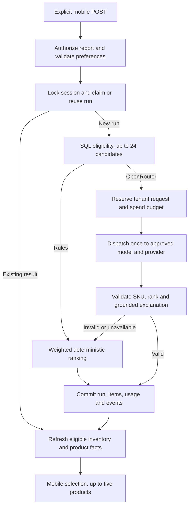
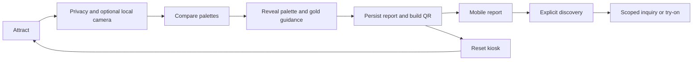
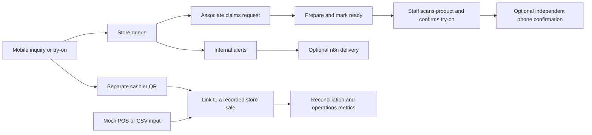
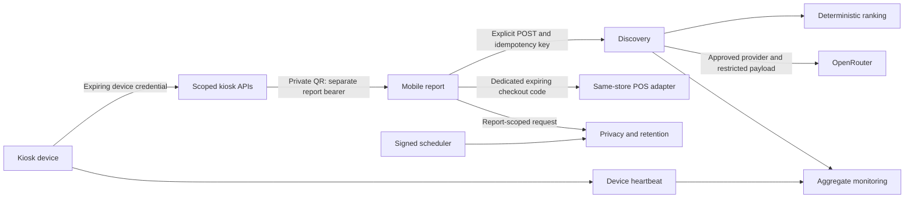

# System architecture

Design baseline for the Puri Mall pilot. The [v2 plan](Sinar_Fajar_Development_Plan_v2.md) defines the delivery phases.

The implementation lives in `src/app` (experience, mobile and operations route groups), `src/domains` (server business logic) and `src/lib` (typed HTTP responses, validation, database and credential handling). Route handlers derive authorization scope before accessing domain data. Tailwind and local shadcn/ui components share theme variables with the configurable organization branding. Fonts are bundled locally.

```mermaid
flowchart LR
    K[Kiosk camera or manual comparison] --> C[Color result and palette]
    C --> Q[QR to private report]
    Q --> M[Mobile report and preferences]
    M --> A[Explicit mobile activation]
    A --> E[Authorize report and select eligible inventory]
    E --> R[Rules or OpenRouter ranking]
    R --> V[Validate SKUs and refresh product facts]
    V --> D[Mobile discovery and inquiry]
```

One Next.js App Router application hosts the kiosk, mobile report and staff surfaces. Domain modules own their server operations and use Prisma with Supabase PostgreSQL. Organization and store scope follow each session, catalog query and event. Sinar Fajar branding and pilot store configuration sit outside reusable domain logic. Development, UAT and production require separate credentials and data.

The kiosk renders color comparisons locally, offers a manual route when the camera is declined and supports an uncertain result. Automated classification requires specialist validation. Reset clears the shared device for the next customer while preserving the issued mobile report.

Inaura selects eligible products, validates model output, handles fallback and records evaluation data. OpenRouter receives a bounded candidate set, minimal preferences and the derived profile through a server-side adapter. Current catalog specifications, price and availability control what the mobile interface displays.

## Catalog and recommendation execution

The claim commits before external I/O. A concurrent request can read progress without holding a database lock across inference. Known rate-limit responses may be retried once within quota and spend limits. Ambiguous transport failures use rules and retain the cost reservation. The admin lab exercises retrieval and validation locally.

## Phase 3 customer experience

The kiosk clears customer state after 90 seconds of inactivity, or 60 seconds on the result screen. Browser camera frames are sampled only for lighting quality and cleared locally. The human-selected tone is independent of that measurement. The report request uses a cryptographically generated credential held in kiosk memory so a lost response can be retried. The database stores the hash and never recovers the plain credential. A failed save leaves the result visible. Kiosk reset closes kiosk access while the mobile report retains its expiration.

IndexedDB buffers event envelopes for up to 24 hours. Kiosk replay uses the enrolled device's HTTP-only cookie and the originating session scope. Mobile replay requires access to the same private report. The outbox stores no bearer tokens or camera material.

### Photo-only catalog for the camera trial

Staff upload product photos to the catalog media bucket and publish reviewed tags under a store. An optional staff action invokes a vision-capable model through OpenRouter to suggest category, apparent metal color, accent families, shape and style. Proposals remain separate from approved tags. The model receives one original catalog photo and a fixed instruction.

After a customer submits the registered trial discovery form, Inaura shortlists up to three approved photos per category. Apparent metal and accent families are compared with the camera palette. The configured mobile ranker picks one item per represented category and chooses a supported styling reason. Rules provide a fallback. Runs are scoped by report and store, and reads recheck photo publication. Phones load original photos through the report origin so clients do not need direct access to the media service. The verified-inventory catalog remains the source of commercial specifications and availability.

## Phase 4 store operations

The queue polls every ten seconds while visible and uses authenticated store scope. Claim and transition updates check the expected state and assignee atomically. Product scanning runs locally in the staff browser. The cashier QR stores a distinct fifteen-minute credential, scoped to the originating store. Sale ingestion and attribution use exact decimal values and store-scoped external references.

## Phase 5 analysis and evaluation

The management application reads scoped session cohorts, interaction events, authoritative recommendation and receipt records and separately approved inputs. The KPI reducer uses set membership and source data to produce per-session metrics, dimension tables and experiment comparisons. Recharts receives aggregate daily series. Export requests run the same scope and filters as the UI. Marketing access excludes money metrics and approved financial inputs.

Kiosk and mobile plans persist independent assignments. Their lifecycle controls enrollment while observation continues for previously assigned participants. Mobile plans snapshot ranking settings, model/provider routing and prompt reference. The evaluation lab compares rules and approved model variants on reviewed synthetic cases. It stores historical metrics and reserves from the same organization provider budget as customer activation. Lab calls never create customer sessions or customer conversion events.

## Phase 6 release boundary

The monitoring read path and mobile inventory rechecks invoke no inference. Scheduled jobs and the monitor have independent credentials. PostgreSQL serializes shared quotas, tracks short-lived job nonces and holds identifier-free API outcome counts. Staff membership and store authorization are verified server-side. Hosted runtime roles, logs, backups and network failover require UAT evidence.

### Local color engine and palette evidence

The authenticated station response selects the permitted kiosk workflow. Calibrated research capture samples faces in a same-origin browser worker. The consented camera track, canvas data, landmarks and region measurements stay in browser memory. Only accepted result references reach the report endpoint. The report stores a resolved swatch snapshot and a separate hashed, expiring mobile token.

Mobile activation reads the immutable palette and optional explicit edits. It scores paginated, eligible originating-store inventory into one bounded pool before choosing the ranking engine. Both engines use the same styling evidence. The provider receives bounded SKU facts, supported reasons and coarse match scores. The server rechecks inventory and evidence before showing a result.
