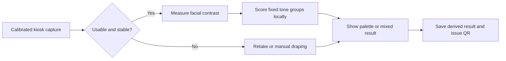

# Personal color analysis engine and validation plan

**Status** — Proposed for Phase 3 research and prototyping. The intended result is an automated ranking of fixed drape palettes from a calibrated kiosk capture. Specialists are unnecessary for collecting volunteer drape preferences or operating the kiosk. Public automated classification remains subject to the [v2 release criterion](Sinar_Fajar_Development_Plan_v2.md#3-local-computer-vision-and-validation), which requires qualified specialist validation. Releasing a volunteer-validated styling predictor without that review would require an explicit project decision.

The [Phase 3 color analysis technical plan](COLOR_ANALYSIS_TECHNICAL_PLAN.md) covers implementation order, module boundaries and delivery tests.

## Questions the pilot must answer

1. Can the station measure local facial lightness contrast consistently after a customer leaves and returns to position?
2. Does facial contrast improve predictions of which drapes a person chooses near their face, over a ranking that ignores the camera?
3. Does the improvement hold across the range of skin lightness and common capture conditions seen at Puri Mall?

The first endpoint concerns measurement repeatability. The second and third concern agreement with a defined styling preference. An internal engineering test can verify that a formula works as specified. The held-out human study is what can justify a statement about the usefulness of that formula.

## Published evidence and proposed use

| Method | Evidence | Application to the kiosk |
| --- | --- | --- |
| Camera color measurement | He et al. compared imaging with spectrophotometer measurements at five facial sites in 60 people, including 15 Indonesian participants. Their equipment and lighting were controlled. [He et al., 2022](https://doi.org/10.1002/col.22737) | Calibrate the actual kiosk device under diffuse light. Record errors on reference patches held out of the calibration fit. The paper supplies the measurement approach. The kiosk hardware needs its own bench results. |
| Color coordinates and calibration error | ISO/CIE 11664-4 defines CIE L\*a\*b\*. Sharma et al. provide test values for implementing CIEDE2000. [ISO/CIE 11664-4:2019](https://www.iso.org/standard/74166.html) · [Sharma et al., 2005](https://www.hajim.rochester.edu/ece/sites/gsharma/ciede2000/) | Express color in a documented reference white and use ΔE₀₀ to check color reproduction on known patches. |
| Facial contrast | Porcheron et al. compared the lightness of facial features with their surrounding skin using an adapted Michelson ratio. Their outcome was age perception. [Porcheron et al., 2017](https://pmc.ncbi.nlm.nih.gov/articles/PMC5524771/) | Apply the published ratio to brow and nearby skin regions. Using both brows, aggregating over frames and using the absolute value are kiosk design choices. |
| Palette hypothesis | In the two facial image contrast conditions described in the public abstract, higher contrast tended to pair with Vivid and Dark, and lower contrast with Pale and Dull. PCCS groups tone by lightness and saturation. [Lee and Park, 2025](https://www.kci.go.kr/kciportal/ci/sereArticleSearch/ciSereArtiView.kci?sereArticleSearchBean.artiId=ART003270888) · [Japan Color Research Institute](https://www.jcri.jp/achievement_1) | Define four tone groups and test the direction of the relationship. The abstract supplies neither camera cutoffs nor a personalized hue rule. |
| Preference experiment and ranking | Perrett and Sprengelmeyer used controlled clothing-color judgments with 12 White women's faces. Turner and Firth describe how to fit paired-comparison scores using explanatory variables. [Perrett and Sprengelmeyer, 2021](https://doi.org/10.1177/20416695211053361) · [Turner and Firth, 2012](https://www.jstatsoft.org/article/view/v048i09) | Adapt the comparison task for local volunteers and fit a small deterministic scorer from their responses. Evaluate on new participants. |
| Jewelry appearance | A perception experiment found that chromaticity, gloss and lightness distribution all affected metallic color appearance. [Metallic color perception study, 2016](https://doi.org/10.5057/jjske.TJSKE-D-16-00010) | Test yellow, white and rose gold with physical samples before claiming a personalized metal match. |

## Engine design



### 1. Capture and calibration

- Use one camera and display configuration per station. Set a fixed distance, diffuse light, neutral backdrop and neutral on-screen capture view. Lock camera settings where the hardware supports it. Verify the actual browser video feed, including the effect of automatic exposure and white balance.
- Fit a camera-to-XYZ mapping from known reference patches and convert to CIE Lab using the recorded white point. Check held-out patches across the intended lightness range. Record station ID, camera settings, calibration revision and chart error. Recheck at store opening and after a camera, light or setting changes.
- Use local facial landmarks to locate both brow regions and adjacent skin. Exclude frames with poor pose, blur, clipping, uneven lighting or obstructed regions. Give the customer one guided retake, then offer manual draping when a stable measurement remains unavailable.

### 2. Facial contrast

Compute the mean L\* for the usable pixels in each brow and its nearby skin region. Calculate the contrast for each side of each usable frame and take the median of those measurements over several accepted frames. Treat regions with an invalid or near-zero denominator as unusable. Set frame count and stability tolerance from the bench and feasibility results.

```text
regionContrast = abs(meanSkinL - meanBrowL) / (meanSkinL + meanBrowL)
facialContrast = median(regionContrast for each accepted frame and side)
```

For adjacent skin at L\* 58 and brow at L\* 36, `regionContrast` is `22 / 94`, or roughly `0.234`. The score is dimensionless. The earlier raw L\* difference example used a different scale, so those example thresholds have no role in calibration.

### 3. Fixed palette library and scoring

Create a versioned set of 20 reference swatches with the same five hue families in each of the four PCCS tone groups. Each entry carries a stable ID, tone, hue, physical reference and display sRGB value. Select swatches against PCCS references, verify the displayed reproduction on the pilot screen and freeze the set before the study. Show several hues within each recommended tone group.

| Candidate | Scoring rule | Purpose |
| --- | --- | --- |
| Population baseline | Rank the offered tone pair by pooled preferences learned on the development participants. Use the same fixed swatches and no camera features. | Measures how well a recommendation works with popularity alone. |
| Contrast rule | Calculate `c = clamp((facialContrast - lowAnchor) / (highAnchor - lowAnchor), 0, 1)`. Vivid and Dark get `c`. Pale and Dull get `1 - c`. Use the development cohort's 20th and 80th contrast percentiles as proposed anchors. Set the zone for mixed results from development-capture repeatability around the midpoint. | Tests the direction from Lee and Park using an explainable rule. The anchor percentiles are prototype choices and the scores are ranking weights. |
| Fitted contrast model | Fit `score(tone) = intercept[tone] + slope[tone] × standardizedContrast`. In a comparison, use `sigmoid(score(A) - score(B))` to estimate the chance A is chosen over B. Fit the contrast standardization and coefficients on development participants, using one reference tone for identifiability. | Tests whether the data warrant distinct scores for the four tones. Compare against the simple rule and the population baseline. |

Use the simplest candidate that meets the registered validation criteria. If the anchors coincide, the contrast rule has insufficient spread to score. Otherwise, both tones within the rule's favored group are equally supported. Near the boundary, show one tone from each group using the development group's within-pair choices as the tie-breaker for display. For the fitted model, use repeat captures to set the minimum score gap for a single-tone result. Freeze the accepted configuration and keep a small versioned TypeScript scorer that runs locally without external inference. Public-facing results describe drapes to try based on measured contrast.

### 4. Named shades and personalized hue ranking

Use the 20 chromatic reference swatches as the first measured study set. Choose hue families across red or rose, yellow or ochre, green, blue and violet. Give individual swatches names customers can recognize, such as dusty rose, sage, steel blue or lavender where the measured references support those names. Add a small display set of neutrals such as soft white, taupe, and charcoal. Store each swatch's measured Lab value, derived hue and chroma where applicable, display sRGB and physical reference. Record the same measurement conditions for each swatch. [ISO/CIE color coordinates](https://www.iso.org/standard/74166.html) · [PCCS hue and tone](https://www.jcri.jp/achievement_1)

The contrast model picks a tone group and can show a varied set of named shades within it. Initially display these as **Suggested colors to try**, with curated neutrals and paired drape previews. A set might include dusty rose, sage, steel blue and lavender, with taupe and charcoal alongside it. That example illustrates report content. The selected swatches and previews depend on the available reference library and the customer's result.

To learn which hues suit a particular customer, add a separate comparison block. Keep each pair as close in measured lightness and chroma as the available drapes permit and vary hue. Fit a small regularized paired-choice model on volunteer judgments. Start within one tone group so the hue test isolates the value added beyond the contrast result.

```text
hueScore(swatch) = swatchPopularity[swatch.id]
                 + dot(hueWeights[swatch.hueFamily], [skinA, skinB])
P(A chosen over B) = sigmoid(hueScore(A) - hueScore(B))
```

Use calibrated skin a\* and b\* values calculated locally. Set one reference hue family's weights to zero for identifiability, fit feature scaling and coefficients on development data and freeze them. Test on independent participants against a swatch-popularity baseline within the same tone group. Report the incremental agreement and uncertainty for decisive hue choices before enabling per-person shade ranking. Until then, use the varied swatch set and optional self-guided comparison. Testing a seasonal label such as **Soft Summer** or ranking metals would require its own evidence. [Clothing-color experiment](https://doi.org/10.1177/20416695211053361) · [Paired-comparison model](https://www.jstatsoft.org/article/view/v048i09)

### 5. Report and mobile boundaries

Extend `ColorAnalysis` with an optional list of suggested tone groups. Keep Vivid, Dark, Pale and Dull distinct from the current `profile` field, which the mobile ranker already uses for metal guidance. Allow a null `profile` for contrast-only reports and use the existing `AUTOMATIC` source. The kiosk report API validates palette IDs against the registered library and derives report swatches from the corresponding version. Existing manual reports keep their original display labels. Mobile discovery reads explicit customer metal preferences and leaves the inferred metal preference empty on a contrast-only report.

Persist only the approved derived result, source, uncertainty and method, palette and calibration revisions needed for provenance. Keep frames, landmarks and region measurements local and ephemeral during normal use. The report stays accessible after kiosk reset. OpenRouter remains available only after explicit authorized mobile discovery activation.

## Puri Mall validation protocol

### Bench and feasibility

- On the intended kiosk, measure held-out chart patches spanning lightness and chroma, record ΔE₀₀ and check calibration drift. Use two independent customer captures with repositioning to measure test–retest differences and result flips. Inspect differences in the continuous score as well as agreement in the displayed tone groups. [Bland and Altman, 1986](https://pubmed.ncbi.nlm.nih.gov/2868172/)
- Start with a proposed feasibility group of 20–30 consenting adults across a range of measured skin lightness and common presentation conditions. Use it to find capture failures, estimate within-person variability and size the later validation cohort. It is a development group and supplies no held-out performance claim.

### Preference data and held-out evaluation

1. Before participants see an engine result, have them choose which of two physical drapes looks more harmonious beside their face under fixed lighting. Use the same hue family within each pair and vary the tone. Balance tone pairs and hue families across participants. Randomize left and right positions and repeat a subset of pairs with reversed positions. Record A, B, both, neither or skipped.
2. Tune the capture rules and candidate scorers on development participants only. Where the primary analysis uses decisive A/B responses, report ties, neither and skips separately so the agreement rate can be interpreted. Keep all sessions of each person on the same side of the development and validation split.
3. Freeze the protocol, sample-size calculation, swatches, calibration requirements, fits and scoring before opening the held-out results. Size that cohort from the feasibility results and the smallest worthwhile improvement. Use a separate consented research dataset with a random study ID, minimum approved derived features and choices, and a retention period. Keep camera frames and landmarks ephemeral in the study as well.
4. On the held-out set, compare each model's predicted winner with the observed choice for the same decisive trials. Give tied model predictions half credit. Report the improvement over the population baseline with a 95% interval resampled by participant to account for repeated choices. Report repeat-capture agreement, coverage and uncertainty by predeclared skin-lightness bands, plus counts for each band. Investigate common conditions such as makeup and glasses.

### Proposed acceptance criteria for the research result

These are proposed product targets. Approve or revise them after feasibility and before viewing held-out results.

| Criterion | Proposed pass condition |
| --- | --- |
| Measurement control | The station stays within the registered held-out patch and drift tolerances. Derive those tolerances from bench repeatability and how much drift changes the reported contrast group. |
| Preference prediction | At least **5 percentage points** higher pair-choice agreement than the population baseline, with the lower bound of the participant-level 95% interval above zero. |
| Repeatability | At least **85%** agreement on the displayed tone result across two eligible captures of the same person, reported with the denominator and interval. |
| Automatic coverage | At least **80%** of camera-consenting participants receive one prioritized tone or a recommendation of Vivid and Dark together or Pale and Dull together. Report retakes, mixed results across those pairs and manual fallback separately. Review all prespecified lightness bands before expanding use. |
| Evidence and reproducibility | Preserve the cited methods, protocol, frozen settings, anonymized aggregate results, sample counts and deviations. A second engineer can reproduce the analysis from the approved research data and versioned code. |

If the scorer misses the acceptance criteria or a subgroup is too small to assess, keep the research result scoped to the tested conditions. The kiosk can continue to offer manual draping while the team revises or reevaluates the model. Use wording such as *“Our kiosk measures facial contrast with a published method and uses it to suggest color palettes.”* Add a claim about agreement with volunteer drape choices only after reporting the measured effect, sample and conditions.

For metal guidance, run a separate preference experiment using real yellow, white and rose gold samples with comparable shape, size and finish. Start with customer-selected metal preferences. A later automated metal score needs its own held-out result against a popularity baseline.

## Phase 3 implementation sequence

1. **Build the bench prototype** with local capture, chart calibration, contrast calculation and stable test fixtures. Verify numerical outputs, bad-input handling and repeat captures on the intended hardware.
2. **Add palette scoring and draping** with the versioned palette library, research-only scoring flag, retake path and manual fallback. Test score boundaries, ties, missing capture data, camera denial and resets.
3. **Run the feasibility and independent validation studies.** Publish the evaluation report internally and submit the product framing and release decision to the project owner.
4. **Wire the validated output into the kiosk and QR report** behind the approved release gate. Verify historical manual reports, server-side palette validation, camera cleanup, no inference on kiosk or report views and no inferred metal preference from a contrast-only report. Run unit, integration and Playwright checks, lint, type checking and build before recording phase acceptance.
