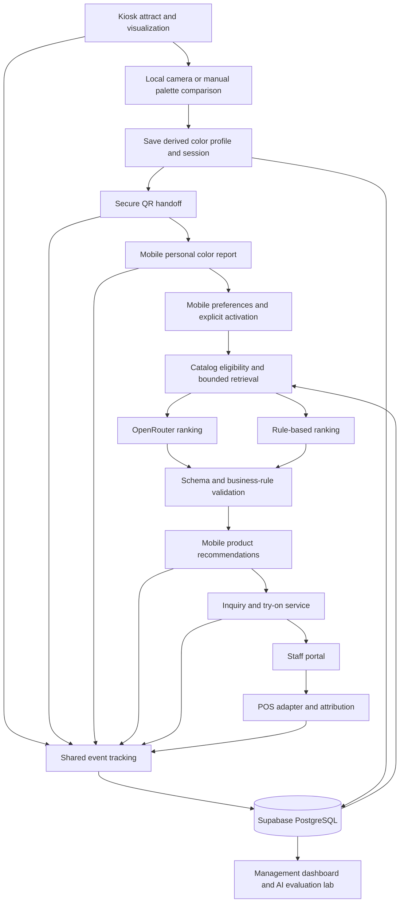

# Sinar Fajar — Project Context

Implementation evidence for the foundation and catalog phases is recorded in [Development progress](DEVELOPMENT_PROGRESS.md). The [environment guide](SETUP.md) covers the isolated development services and the configuration required for live provider verification.

## Executive Summary — Project Owner Brief

> [!abstract] For Aurel — Project Owner
> **Purpose:** Turn the Sinar Fajar grand opening experience at Puri Mall into a measurable customer acquisition and jewelry discovery channel, then assess whether the platform is worth retaining and expanding to other outlets.
>
> **Concept:** Customers enjoy an interactive personal color experience at the store kiosk, receive a meaningful color palette and scan a unique QR code to continue on their phones. The mobile page provides the personal report and, when the customer chooses to proceed, AI-powered jewelry recommendations from Sinar Fajar's actual catalog. No app download or account is required.
>
> **Business value:** The kiosk attracts and engages customers; the QR handoff measures voluntary interest; mobile product clicks, inquiries, physical try-ons and verified purchases indicate commercial engagement. These stages are measured independently, without relying solely on employee reports.

### At a glance

| Topic | Project direction |
|---|---|
| Pilot | Sinar Fajar, Puri Mall grand opening; ongoing store pilot afterward |
| Project owner | Aurel — client-side coordination, scope and approval |
| Technology partner | Inaura Research Labs (proposed) — design, development, integration and evaluation |
| Kiosk | Interactive color draping, palette visualization, result reveal and QR handoff; no personalized SKU recommendations |
| Customer phone | Personal color report, shopping preferences, AI-ranked jewelry, inquiries, try-on requests and sharing |
| AI | OpenRouter ranks eligible products or approved trial photos after explicit mobile activation. Staff can request visual tag suggestions when preparing catalog photos. Inaura controls filters, approval, validation and fallback. |
| Delivery | Indicative eight-week development window; 30–60-day post-opening evaluation, subject to readiness |
| Budget | Not confirmed; hardware, development, integration and recurring operating costs require approval |

### How success will be measured

| KPI                                                                                                      | Proposed pilot goal |
| -------------------------------------------------------------------------------------------------------- | ------------------: |
| Kiosk adoption (starts / eligible visitors)                                                              |                ≥25% |
| Analysis completion (completed / started analyses)                                                       |                ≥85% |
| **QR handoff (unique mobile report opens / completed analyses)**                                         |            **≥60%** |
| Mobile recommendation activation (successful recommendations / human report opens)                       |                ≥80% |
| **Product CTR (recommendation-viewing sessions with a product click / recommendation-viewing sessions)** |            **≥40%** |
| Mobile inquiry (voluntary inquiry sessions / report sessions)                                            |                ≥20% |
| Inquiry-to-try-on (verified try-on / inquiry sessions)                                                   |                ≥60% |
| Try-on-to-purchase (verified purchase / confirmed try-on sessions)                                       |                ≥25% |
| Customer satisfaction                                                                                    |              ≥4.3/5 |

The **QR handoff rate** is the main kiosk conversion KPI; **product CTR** is the main mobile recommendation engagement KPI. Neither alone proves incremental sales. Targets are proposed hypotheses, not approved commitments or industry benchmarks. Purchases and financial contribution require reliable attribution and comparison data.

### What Aurel needs to coordinate

- Confirm launch date, budget, event objectives, pilot scope, store layout and named PICs.
- Obtain verified sample product data (proposed 50–100 SKUs), product photos, branding assets and a complete pilot catalog before launch.
- Connect Inaura with the POS/inventory provider for API documentation, sandbox access or an agreed CSV-based alternative.
- Arrange a qualified personal color specialist to approve methodology and visual results; approve a manual comparison fallback if automation is not yet validated.
- Confirm hardware procurement, staff fulfillment workflow, privacy notice, report retention, and approval of external AI processing.
- Approve KPI definitions, baseline collection, UAT and deployment; review results before any multi-store rollout.

**Decision gate:** Launch only when the kiosk-to-phone journey works, catalog information is verified, privacy and hardware checks pass, and staff are trained. Actual POS integration may be staged if an approved reconciliation method exists; disclose that limitation. Do not approve rollout solely because the opening attracts attention; evaluate ongoing engagement, incremental contribution, expected payback and operational feasibility.

---

> [!info] Document purpose
> The remaining sections are the detailed product and technical reference. This revision aligns the project context with the experience-first architecture in [[Sinar_Fajar_Development_Plan_v2|Development Plan V2]]. It supersedes the previous kiosk-recommendation workflow.

## 1. Background and objectives

Sinar Fajar is introducing a multi-brand jewelry retail concept at Puri Mall. The original discussion focused on personal color analysis, recommendations for yellow, white and rose gold, and improving the customer buying experience. The grand opening prioritizes exposure and engagement; voluntary product inquiries and physical try-ons are additional successes, with purchases a downstream outcome. The permanent installation must demonstrate business value independently of the opening event.

- Grand opening: attract visitors, encourage participation, generate measurable brand exposure and voluntary social sharing.
- Ongoing operations: improve product discovery, relevant recommendations, product inquiries, try-ons and purchase conversion.
- Management: determine whether the system produces incremental financial value and merits deployment across stores.
- Inaura: establish a reusable retail recommendation and intelligence platform and an applied AI business research case.

**Non-goals for the MVP:** training a proprietary foundation model, unrestricted AI database access, facial recognition, comprehensive seasonal color diagnosis, virtual try-on, autonomous pricing, or multi-store rollout before pilot evaluation.

## 2. Confirmed direction vs proposals

- [x] The kiosk focuses on immersive personal color visualization, not product recommendations.
- [x] QR handoff is the measurable bridge to a no-account mobile report.
- [x] Product discovery, shopping preferences and personalized SKU recommendations occur only on mobile.
- [x] Use OpenRouter for external LLM inference after explicit mobile activation; Inaura owns orchestration and evaluation.
- [x] Measure QR handoff and mobile product CTR separately.
- [ ] Confirm client budget, launch date, scope, product data and POS integration.
- [ ] Validate automated color classification with a specialist and representative participants; retain the manual visualization fallback.
- [ ] Approve KPI targets, privacy controls and pilot experiment design.

The architecture direction was agreed in the project discussion; client sign-off, technical performance, hardware specifications, schedule and numerical targets are still pending.

## 3. Customer experience

### Stage A — Physical experience (kiosk)

1. Animated attract screen invites a customer to start an anonymous/pseudonymous session.
2. Present privacy notice and request optional camera permission; no account or marketing opt-in is required.
3. Guide local camera capture and lighting checks. Offer a meaningful manual palette comparison if permission is declined, capture quality is poor or automated classification is unvalidated.
4. Visualize digital color draping and palette comparisons; reveal a validated, manual or uncertain color profile with clear labeling.
5. Show illustrative yellow, white and rose gold color guidance, not actual personalized SKUs.
6. Persist approved derived report data and display a unique QR code inviting the customer to discover jewelry on their phone.
7. Reset the kiosk, stop the camera and clear temporary data without invalidating the mobile report.

### Stage B — Digital experience (customer phone)

1. Scan QR using the phone camera to open a private mobile report without an account or app installation.
2. View personal color palette and styling guidance. Select or correct preferences: style, occasion, category, budget and preferred gold colors. Nonessential inputs may be skipped.
3. Explicitly activate jewelry discovery. Only this authorized mobile action can initiate customer inference; report opens, previews and kiosk events never trigger OpenRouter.
4. Retrieve eligible products from Sinar Fajar's catalog; rank through OpenRouter or the deterministic control/fallback engine.
5. Validate SKU, availability, current price and specifications before display. Show personalized reasons as styling guidance.
6. Explore products, voluntarily inquire, request a try-on, save/share a public-safe result or opt in to marketing separately.
7. For customers no longer in-store, distinguish later contact from immediate staff fulfillment requests.

### Stage C — Retail conversion

Staff receives the mobile request, retrieves jewelry and scans the SKU. Customer confirmation records a physical try-on where practical. At checkout, a distinct scoped attribution code on the phone may link the verified POS transaction to the originating session; never reuse the private report token in POS logs. All channels feed the management dashboard.

Usher assistance is optional. Track assisted versus self-service separately to avoid confusing prompted activity with voluntary interest. Do not withhold meaningful color results to force a QR scan; do not require social follows or marketing consent to use the permanent service. Opening incentives require separate approval and privacy review.

## 4. Architecture



### Recommendation engine

- **Activation:** only an explicit authorized mobile POST may initiate customer inference. Deduplicate concurrent/repeated activation, reuse eligible unchanged results and revalidate stock and prices. Kiosk credentials, QR display, GET requests, previews and prefetch must not invoke OpenRouter.
- **Retrieval:** filter by store, availability, category, budget and other explicit constraints in PostgreSQL. Start with SQL; consider pgvector only if semantic retrieval becomes useful.
- **Inference:** send a bounded list of eligible products and the minimal, non-identifying preference profile to OpenRouter. Compare supported models for quality, latency, structured response reliability, cost and privacy policy.
- **Validation:** require structured JSON; reject unknown or duplicate SKUs, ineligible items and malformed results. Recheck current stock and prices before display. Use only authoritative catalog values for product facts; generated copy is styling guidance, not a guarantee.
- **Fallback:** deterministic ranking based on preference and product tags when provider fails, returns invalid output, or exceeds latency/cost limits. Log fallback separately.
- **Evaluation:** version prompts, models, retrieval and ranking policies. Compare rule-based and LLM variants; human review drives improvements initially. Behavioral learning is a later option, not automatic model retraining.

Example request (illustrative):

```json
{
  "customer_profile": {
    "color_profile": "warm-leaning",
    "preferred_style": "minimalist",
    "occasion": "daily wear",
    "budget_idr": 5000000,
    "category": "necklace"
  },
  "eligible_products": [
    {"sku": "SF001", "gold_color": "yellow", "purity": "18K", "style": "minimalist", "price_idr": 3500000},
    {"sku": "SF002", "gold_color": "rose", "purity": "18K", "style": "elegant", "price_idr": 4200000}
  ]
}
```

Example response (illustrative):

```json
{
  "recommendations": [
    {"sku": "SF001", "rank": 1, "reason": "Matches your minimalist daily-wear preference and warm-leaning palette."},
    {"sku": "SF002", "rank": 2, "reason": "A softer alternative within your budget."}
  ]
}
```

No raw customer facial images, identity details, supplier costs or complete inventory database are needed for the LLM request. Color associations are subjective styling guidance and must not be presented as scientifically definitive.

## 5. Proposed software stack

| Component | Technology | Purpose |
|---|---|---|
| Customer kiosk, report and staff apps | Next.js, TypeScript | Responsive web app / PWA |
| UI | Tailwind CSS, shadcn/ui | Touch-friendly retail experience |
| API | Next.js server routes | Session, catalog, recommendation and event APIs |
| AI | OpenRouter, Vercel AI SDK or compatible SDK | External inference, model routing |
| Validation | Zod | Structured outputs and request validation |
| Local vision / visualization | MediaPipe, OpenCV.js | Local landmarks, color extraction and calibration |
| QR / report tokens | qrcode or qrcode.react, Node.js Crypto | Secure mobile handoff |
| Visualization | CSS / Canvas, accessible animation | Interactive color draping and result reveal |
| Database | Supabase PostgreSQL | Catalog, stock, events, sessions, transactions |
| ORM | Prisma | Data access and migrations |
| Authentication | Supabase Auth | Staff and admin RBAC |
| Product images | Supabase Storage | Catalog photography |
| Search | SQL; pgvector optional | Candidate retrieval |
| Automation | n8n | Staff notifications and POS/CRM integration |
| Analytics | First-party event pipeline; optional PostHog | Behavioral analytics; avoid sensitive data capture |
| Dashboard | Next.js + Recharts | Retail KPIs and experiment results |
| Offline support | IndexedDB | Local event queue, safe retry and deduplication |
| Deployment | Vercel; Chromium kiosk mode | Hosted app and on-site runtime |
| Monitoring | Sentry / Uptime Kuma or equivalent | Errors and uptime |
| Source control | GitHub | CI/CD and versioning |

Mobile routes: `/results/[token]` (report and preferences), `/results/[token]/discover` (recommendation activation and results), `/results/[token]/product/[sku]` (product detail). `/kiosk` is reserved for color experience and QR handoff. Staff, dashboard and admin routes remain separate.

No dedicated GPU or Python inference server is expected for the MVP, contingent on browser performance. Keep model API keys server-side. Apply timeouts, quotas, rate limits, retry policies, tenant isolation, audit logging and catalog access controls.

## 6. Proposed hardware (one pilot store)

| Item | Specification / quantity |
|---|---|
| Touchscreen | 1 × 24–32-inch capacitive display, portrait or landscape after UX testing |
| Mini PC | 1 × modern Intel Core i3/i5 or equivalent; 8–16 GB RAM, 256–512 GB SSD |
| Camera (planned, consent optional) | 1 × 1080p or better, adjustable exposure and white balance |
| Lighting (camera path) | 2 × controlled high-CRI LED lights; target CRI ≥95, around 5500K |
| Calibration (camera path) | Color reference chart; daily calibration check |
| Enclosure | 1 × lockable retail-grade kiosk enclosure |
| Power | UPS sized to measured load, surge protection |
| Network | Ethernet/Wi-Fi and mobile backup |
| Staff device | Existing smartphone/tablet or 1 dedicated tablet |
| QR/POS scanner | Existing compatible 2D scanner or 1 replacement |
| Footfall counter | Optional anonymous entrance counter for visitor-denominator metrics |

Interactive color visualization is a core kiosk feature. Camera-based visualization is planned, but camera permission is optional and automated classification must not ship before validation. A manual comparison route is required; test whether automated analysis improves QR handoff and customer satisfaction separately from mobile ranking outcomes. Confirm hardware compatibility, physical security, store layout and capacity before procurement.

## 7. Data model and tracking

Core entities: `organizations`, `stores`, `devices`, `products`, `inventory`, `sessions`, `color_analyses`, `mobile_report_tokens`, `customer_preferences`, `recommendation_runs`, `recommendation_items`, `events`, `inquiries`, `tryons`, `transactions`, `transaction_items`, `consents`, `experiments`, `experiment_assignments`, `feedback`, `model_configs`, `prompt_versions`.

Product fields: stable SKU, brand, manufacturer, category, gold color, purity, weight, gemstone, design/style tags, occasion tags, current price, stock status, store/display location and verified image/specification references.

Store only approved derived color characteristics, palette, source/methodology version, quality/uncertainty and consent references. Store hashes of cryptographically secure random report tokens, expiry and revocation metadata; use separate kiosk authorization and cashier attribution codes.

### Shared measurement contract (implement from Phase 1)

All events carry unique event ID, originating session, organization/store/device scope, channel, timestamp, relevant run/SKU and assigned experiment versions. Backend events are authoritative for persistence, recommendation generation and verified transactions. Client events must reflect actual visibility/actions. Avoid PII, private tokens and camera data in events.

| Event | Trigger |
|---|---|
| `kiosk_session_started` | Customer starts experience |
| `color_analysis_started` | Begins camera or manual comparison |
| `color_analysis_completed` | Derived or manual result persisted; method and quality recorded |
| `color_result_viewed` | Result visible on kiosk |
| `qr_displayed` | Working report QR actually visible |
| `mobile_report_opened` | Human-visible report open; exclude previews and deduplicate first open |
| `mobile_preferences_completed` | Mobile shopping preferences submitted or intentionally skipped |
| `recommendation_requested` | Explicit authorized mobile activation |
| `recommendation_generated` | Server returns validated ranking; actual strategy and fallback recorded |
| `recommendation_impression` | At least one recommended product card visible |
| `recommended_product_clicked` | Voluntary click on recommended SKU; run and rank recorded |
| `product_detail_viewed` | Mobile product detail visible |
| `product_inquiry_requested` | Voluntary product inquiry |
| `tryon_requested` / `tryon_confirmed` | Request / verified physical interaction |
| `purchase_completed` | Verified POS-linked sale, with refund reconciliation |
| `report_revisited` | Human return in a defined later visit window |
| `report_share_initiated` / `results_saved` | Explicit share initiation / save action |
| `social_link_clicked` / `marketing_opt_in` | Outbound click / independent consent |
| `feedback_submitted` / `recommendation_fallback` | Survey / server fallback |

Use these canonical names in code; migrate old event names explicitly if already implemented, rather than double-counting. Mark unverifiable events as such. A raw QR HTTP request is not proof of a scan; report open is the measurable proxy.


Track unlinked purchases and verbal inquiries as unobserved rather than claiming full attribution. Reconcile event delivery with server/POS records. Recommendation logs include model, prompt version, latency, tokens/cost, validity, assigned strategy, actual strategy and fallback.

## 8. KPIs and targets

### KPI scorecard (proposed pilot targets, not benchmarks)

| Metric | Unique-session calculation | Target |
|---|---|---:|
| Kiosk adoption | Started kiosk sessions / eligible store visitors (footfall required) | ≥25% |
| Analysis completion | Completed analyses / started analyses | ≥85% |
| QR display coverage | Completed sessions with QR visible / completed analyses | Track; target near 100% |
| **QR handoff rate** | Completed analysis sessions with human mobile report open / completed analysis sessions | **≥60%** |
| Mobile activation | Report sessions with successful generated recommendations / human report sessions | ≥80% |
| **Product CTR** | Recommendation-viewing sessions with ≥1 recommended SKU click / recommendation-viewing sessions | **≥40%** |
| Mobile inquiry rate | Report sessions with voluntary inquiry / report sessions | ≥20% |
| Inquiry-to-try-on | Inquiry sessions with verified try-on / inquiry sessions | ≥60% |
| Try-on-to-purchase | Confirmed try-on sessions with verified purchase / confirmed try-on sessions | ≥25% |
| Mobile return rate | Report sessions reopened in a defined later window / report sessions | ≥15% |
| Recommendation relevance | Positive relevance ratings / responses | ≥85% |
| CSAT | Mean rating, report response count and rate | ≥4.3/5 |
| AI inquiry uplift | Relative difference in assigned-group inquiry rates | +15% |
| AI purchase uplift | Relative difference in assigned-group purchase rates | +10% |
| AI cost per completed recommendation | Total inference cost including retries / completed recommendations | ≤USD 0.02 |
| AI calls for unactivated kiosk sessions | Count customer inference requests without authorized activation | 0 |
| Invalid SKU displayed | Invalid displayed SKUs / displayed SKUs | 0% |
| AI response validity / latency | Valid raw responses / attempts; p95 elapsed recommendation time | ≥99%; ≤5s |
| Store-hours uptime / event completeness | Monitored available time; reconciled event delivery | ≥99.5%; ≥99% |

Maintain agreed attribution windows, cohort date rules, time zone and refund policies. Report missing footfall or POS linkage as unavailable; never count repeated scans, previews, repeated taps or employees' actions as unique customer conversions. For product-level CTR, use visible SKU impressions as denominator and label separately. Compare kiosk and mobile outcomes independently. Track opening and permanent-store cohorts separately.

Additional operational and campaign measures (proposed): self-service completion ≥80%; average kiosk session ≤3 minutes; staff acknowledgment ≤2 minutes; eligible assisted POS linkage ≥90%; successful fallback on eligible failures 100%; zero critical privacy/security incidents and zero persistent raw facial image storage. Measure saves, shares, social link clicks, separate marketing opt-ins, verified campaign posts, follower growth and reach where reliable data exists. For social outcomes, use actual account or verified campaign data; a click or share attempt does not establish a follow or published post. Report survey response counts/rates and experiment uncertainty.

## 9. Experiment and business case

Two separate research questions:

| Experiment | Comparison | Primary outcome |
|---|---|---|
| Kiosk experience | Randomized reveal/visualization and QR CTA designs | QR handoff among all assigned eligible kiosk sessions; completion-conditioned handoff is diagnostic |
| Mobile recommendation | Rules-based ranking (B) vs OpenRouter ranking (C), same eligible products and UI | Voluntary product click or inquiry, prespecified before the trial |
| Overall transformation (optional) | Standard retail offer (A) vs digital experience offer (B/C) | Incremental gross profit or contribution per eligible visitor |

Randomize kiosk variants before exposure and mobile ranking after eligibility and explicit activation but before recommendations. Use original assignments for primary comparisons, including fallback; record actual strategy separately. Keep staffing, promotions, catalog eligibility and measurement comparable. Predefine sample sizes, follow-up windows, outcomes and minimum meaningful effect. Report sample sizes, absolute/relative differences and confidence intervals. Do not infer causal impact from self-selected kiosk users versus non-users. Test manual versus validated automated color visualization separately if feasible. Separate opening and ongoing store cohorts.

Primary event KPI: QR handoff. Primary mobile engagement KPI: product CTR. Primary commercial action: voluntary mobile inquiry. Primary financial decision KPI: incremental contribution per eligible visitor versus control. Social exposure and attributed sales are not evidence of incremental profitability.

Financial model:
- Incremental contribution = incremental gross profit minus incremental operating costs (include model inference, hosting, maintenance and additional labor).
- Payback months = upfront investment / positive monthly incremental contribution.
- First-year ROI = (12 × monthly incremental contribution − upfront investment) / upfront investment.
- Proposed scale gate: positive incremental contribution, expected payback ≤12 months, acceptable customer experience and no critical privacy/security incidents.

Illustrative LLM cost, not a quote: 3,000 input and 500 output tokens at assumed USD 0.30/1M input and USD 2.50/1M output = USD 0.00215 per request. 3,000 paid requests/month = USD 6.45 before retries and other infrastructure. Actual cost depends on mobile activation, AI variant allocation, model selection, regeneration and retries. No customer inference is charged for unactivated kiosk sessions by design.

## 10. Implementation plan (proposed)

| Phase | Proposed weeks | Deliverable / gate |
|---|---|---|
| 1 — Foundation | 1–2 | Secure session, report-token, catalog schema, auth, tenant isolation and event infrastructure |
| 2 — Catalog and recommendation engine | 2–3 | Approved sample catalog; reliable deterministic and OpenRouter ranking with mobile-only activation |
| 3 — Kiosk and mobile experience | 3–5 | Meaningful color visualization, validated or manual result, secure QR handoff, independent mobile discovery and event tracking |
| 4 — Retail operations and sales | 4–6 | Staff queue, try-on confirmation, scoped checkout attribution, POS adapter and reconciliation |
| 5 — Retail intelligence and AI evaluation | 5–6 | QR and mobile CTR dashboards, independent experiments, data-quality and financial metrics |
| 6 — Security, UAT and readiness | 6–8 | Tested devices, privacy review, staff training, client sign-off and controlled deployment |
| Post-opening pilot | Following 30–60 days | Evaluate ongoing commercial impact, operational feasibility and rollout go/no-go |

Use the six development prompts in [[Sinar_Fajar_Development_Plan_v2|Development Plan V2]]. Overlapping weeks are indicative workstream windows, not permission to skip prerequisites. Security, testing and analytics begin in Phase 1. A limited approved catalog and CSV reconciliation can support a standalone pilot if live APIs are not available; never represent stale data as live or claim full sales attribution before verified integration.

### Client dependencies and data/API requirements

| When needed | Sinar Fajar deliverable | Suggested PIC |
|---|---|---|
| Before design | Confirm opening date, budget, site, campaign objectives and scope | Aurel / management |
| Before catalog prototype | Verified sample dataset (proposed 50–100 SKUs), product images, taxonomy and price/availability fields | Product team |
| Before UX design | Approved logo, brand guidelines, customer language, marketing links and color references | Marketing / color specialist |
| Before integration | POS/ERP/inventory vendor names and versions, API docs, sample payloads, sandbox and approved access method | IT/vendor |
| Before kiosk UAT | Store floor plan, lighting, power, network, device procurement and specialist validation | Operations / specialist |
| Before launch | Full approved pilot catalog, agreed stock/price update process, staff workflow, privacy notice and deployment approval | Aurel / relevant PICs |
| Before commercial evaluation | Footfall, transactions, sales by SKU, baseline inquiry/try-on data where available, aggregated margins and costs | Operations / finance |

Request read-only product, SKU, price, stock, store, transaction and refund access where supported. Request limited transaction reference write access only if needed for attribution. Obtain documented endpoints, authentication, schemas, pagination, rate limits, update frequency, webhooks, error handling, sandbox/test data and access/licensing constraints. Do not assume vendor endpoint paths. If unavailable, use approved CSV import/export with freshness indicators, reconciliation and explicit limitations. No unrestricted database access or customer identity exports are needed.

Securely transfer credentials; do not put them in notes, chat or source control. Maintain the client dependency brief separately if needed.

## 11. Privacy and sovereignty

| Data | Internal handling | External inference |
|---|---|---|
| Raw face image / landmarks | Optional local ephemeral processing; discard after use | Never |
| Identity and contact info | Separate restricted store, optional and purpose-limited | Never |
| Color/style profile and budget range | Minimal retention per approved policy | Minimal non-identifying subset if permitted |
| Public product facts | Catalog | Eligible candidate subset |
| Supplier costs, margin, stock database, historical sales | Restricted business data | Never in MVP |
| Interaction events | First-party analytics, retention policy | Never in MVP |

External inference is not sovereign compute. Review OpenRouter and selected provider terms, data retention, processing geography, contractual obligations and applicable Indonesian privacy law before launch. Configure provider allowlists and suitable retention settings; disable unnecessary logging and session replay on sensitive screens. Use least privilege, data deletion procedures and security testing. No facial recognition or identity matching.

### QR report privacy

Use an opaque cryptographically secure token, store only its hash, scope access to a single report and support expiry/revocation. Proposed validity: 30 days, pending approval. Anyone holding the private report link can access it until expiry; communicate this limitation. Use noindex, private/no-store caching, restrictive referrer policy and sanitized logs; exclude tokens from analytics and third-party scripts. Public sharing must use a separate safe card/link, not the private report token. Kiosk reset must not revoke the authorized mobile report.

## 12. Responsibilities and ownership

| Role | Responsibility |
|---|---|
| Aurel — Project Owner | Coordinate client requirements, PICs, scope, acceptance and decisions; escalate budget/approval to management as required |
| Sinar Fajar management | Sponsor, budget, success criteria and rollout decision |
| Inaura Research Labs (proposed) | Architecture, recommendation orchestration, UX, analytics, testing and evaluation |
| Marketing / EO | Campaign execution, exposure metrics and event operations |
| Store manager / staff | Product fulfillment, kiosk operation and POS workflow |
| POS/catalog provider | Inventory and transaction data interface |
| Color specialist | Validation and methodology |
| Data protection lead | Consent, governance and provider assessment |

Inaura retains reusable platform IP subject to contract; Sinar Fajar retains control of client-specific business and customer data subject to contract. External model providers retain their model IP. No cross-client reuse of customer records without appropriate authorization and legal basis.

## 13. Risks and open decisions

- [ ] Confirm actual opening date, budget and desired throughput; calculate kiosk capacity from session duration and opening hours.
- [ ] Obtain representative product catalog, SKU taxonomy, price/stock update frequency and POS API details.
- [ ] Obtain baseline traffic, inquiry/try-on rates, sales, transaction values, margins and campaign reach.
- [ ] Validate automated color classification, palette visuals and manual fallback; test added value separately.
- [ ] Confirm QR handoff CTA, retention (proposed 30 days), trusted domain, public-safe sharing, cohort measurement window and mobile activation UX.
- [ ] Benchmark OpenRouter candidate models and confirm privacy policies, supported structured outputs and spend limits.
- [ ] Agree attribution window, return/cancellation handling and treatment of unmatched transactions.
- [ ] Approve privacy notice, retention schedule and marketing consent flow.
- [ ] Confirm store layout, lighting, network and staff workflow.
- [ ] Agree ownership/licensing, support SLA and rollout acceptance criteria.

## 14. Related context

Suggested Obsidian links (resolve/create only if consistent with existing vault structure): [[Inaura Research Labs]], [[Inaura Retail Intelligence]], [[AI Recommendation Engine]], [[OpenRouter]], [[Digital Transformation]], [[Retail Intelligence]], [[Management Control]], [[AI Evaluation]].

Source: Sinar Fajar meeting transcript provided in chat and follow-up project design discussion dated 2026-11-25. The original meeting established marketing exposure and customer engagement as priorities; OpenRouter, the experience-first kiosk, QR handoff and mobile-only SKU recommendation architecture were agreed in subsequent project discussions. Aurel was identified by the user as Project Owner. All example products, scores, financial assumptions, implementation details and KPI thresholds are illustrative proposals unless subsequently approved.


## Pilot release controls

Phase 6 maintains independent UAT and production release gates. Review `PRODUCTION_READINESS.md` for current evidence, `UAT.md` for client scenarios, `DEPLOYMENT.md` for operations and recovery, and `HANDOVER.md` for the retail and kiosk guides. No production deployment takes place before client UAT acceptance and separate project-owner approval.
