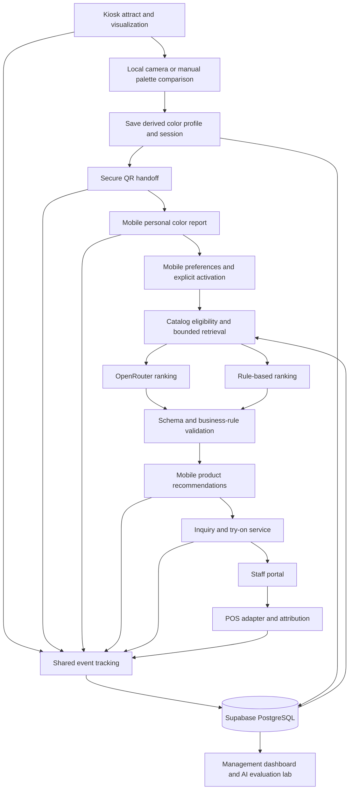
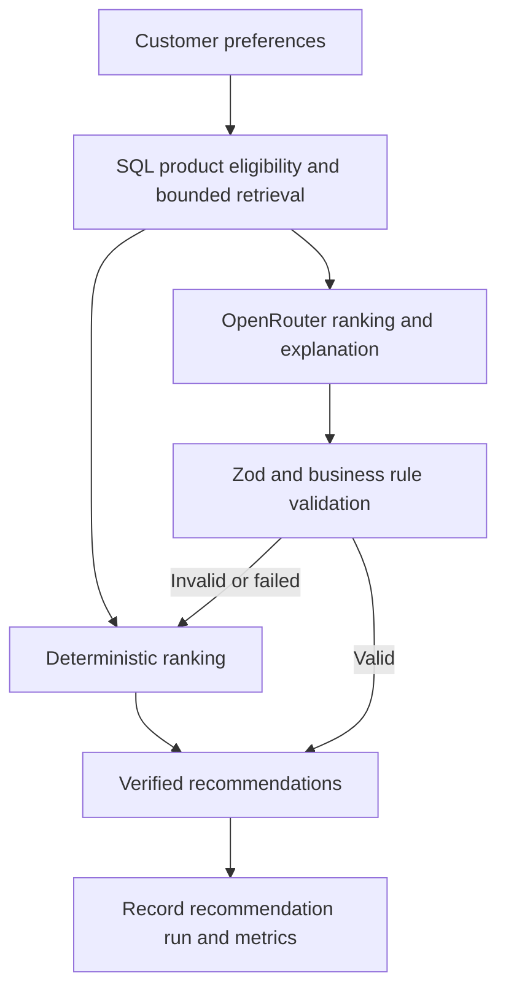
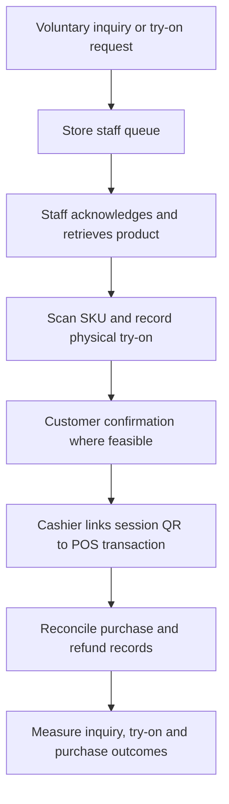

# Sinar Fajar — Software Development Plan

> [!abstract] Project direction
> Build an experience-first retail platform. The Sinar Fajar kiosk delivers interactive personal color visualization, a meaningful color result and a QR handoff. Personalized SKU recommendations and customer shopping happen exclusively on mobile after explicit activation. OpenRouter provides external LLM inference; Inaura owns orchestration, business rules, experience, tracking and evaluation. The first deployment is the Puri Mall pilot. This revision supersedes the original kiosk-recommendation architecture in any older Project Context or agent instructions.

Related notes: [[Project Context]], [[Architecture]], [[KPI Definitions]], [[Development Progress]], [[Decisions]] (suggested links; create or resolve against the vault as appropriate).

## Revision decisions (v2)

- [x] Kiosk = immersive personal color experience; no personalized SKU cards, shopping questionnaire or OpenRouter inference on the kiosk.
- [x] QR code = physical-to-digital conversion point; one secure report per originating session.
- [x] Mobile = personal color report, preferences, AI recommendations, product discovery and commercial CTAs.
- [x] Measure QR handoff and mobile product CTR independently.
- [x] Compare kiosk experience/CTA variants separately from mobile ranking variants.
- [ ] Validate color analysis with a specialist; provide a manual interactive palette route when consent, capture quality or validation is insufficient.
- [ ] Confirm targets, retention, branding, POS and real product data with the client.

The camera-based experience is now a core P0 workstream; automated classification is gated on validation, not assumed accurate. A manual visual comparison is the fallback, not an AI diagnosis.

## Development roadmap

| Phase | Scope | Proposed weeks | Deliverable |
|---|---|---|---|
| 1 | Foundation and infrastructure | 1–2 | Application skeleton, database, access control, event foundation |
| 2 | Product catalog and AI recommendation | 2–3 | Working catalog and recommendation API |
| 3 | Experience-first kiosk and mobile AI | 3–5 | Color visualization, secure QR handoff, mobile recommendations |
| 4 | Retail operations and sales | 4–6 | Staff workflow and testable sales attribution |
| 5 | Retail intelligence and AI evaluation | 5–6 | Management dashboard and AI evaluation laboratory |
| 6 | Security, UAT and production readiness | 6–8 | Tested release candidate and deployment documentation |

Use the master prompt once, then submit the individual phase prompts in order to Claude Code or Codex. Each phase must be implemented, tested, documented and reviewed before proceeding. The overlapping weeks are indicative workstream windows, not a guarantee of delivery or permission to skip dependencies.

## Application architecture



| Route | Purpose |
|---|---|
| `/kiosk` | Attract, local color visualization, result reveal and QR handoff only |
| `/results/[token]` | Mobile personal color report and preferences |
| `/results/[token]/discover` | Explicit activation and AI-ranked jewelry discovery |
| `/results/[token]/product/[sku]` | Mobile product details and inquiry / try-on CTA |
| `/staff` | Sales associate operations |
| `/dashboard` | Management and retail intelligence |
| `/admin` | Catalog, organization and store administration |
| `/admin/ai-lab` | Restricted AI evaluation and experiment management |

## 00 — Master project instruction

> [!tip] Usage
> Place [[Project Context]] in the software repository as `docs/PROJECT_CONTEXT.md`. Submit the following master instruction once. Preserve the persistent engineering instructions in `CLAUDE.md` and `AGENTS.md`.

```text
# Project: Inaura Retail Intelligence — Sinar Fajar

Act as the lead software architect and senior full-stack engineer for Inaura Retail Intelligence, with Sinar Fajar as the first client implementation.

Read docs/PROJECT_CONTEXT.md and this v2 plan before making architectural or implementation decisions. If earlier context conflicts with v2, follow the experience-first architecture and document the decision.

## Product vision
Build an immersive personal color kiosk that hands customers off via QR to a mobile jewelry discovery platform. Only explicit mobile recommendation activation invokes customer inference through OpenRouter. Staff can separately request visual tag suggestions for catalog photos. Approved trial photos support visual styling recommendations while verified inventory supports commercial product discovery. The kiosk is complete as a color experience without AI product rankings.

Inaura owns the recommendation orchestration, customer experience, business logic, analytics and evaluation infrastructure. OpenRouter provides external AI inference.

## Technology stack
- Next.js App Router
- TypeScript
- Tailwind CSS
- shadcn/ui
- Supabase PostgreSQL
- Prisma ORM
- Supabase Auth
- Supabase Storage
- OpenRouter (server-side compatible SDK or Vercel AI SDK)
- Zod
- MediaPipe and OpenCV.js for local camera/color visualization
- qrcode or qrcode.react; Node.js Crypto for secure report tokens
- CSS/Canvas and accessible animation (respect reduced-motion preferences)
- Recharts
- n8n for external automation
- Vitest and Playwright
- IndexedDB for offline event recovery
- Vercel
- GitHub

## Engineering principles
- Use a modular monolith architecture.
- Design for multiple organizations and stores without prematurely implementing complex SaaS functionality.
- Separate reusable Inaura platform functionality from Sinar Fajar-specific branding and configuration.
- Use strict TypeScript.
- Implement security and authorization at the server level.
- Never expose sensitive credentials to the frontend.
- Never allow AI-generated information to override authoritative product specifications, prices or inventory.
- Make interactive color visualization a core kiosk feature; camera permission is optional and automated classification stays disabled until validated. Provide manual comparison and uncertain-result paths.
- Never generate or display personalized SKU recommendations on the kiosk. A QR GET, crawler, preview, or report view alone must never invoke OpenRouter.
- Keep the kiosk session and mobile report authorization separate; kiosk reset must preserve the report token.
- Track physical-to-digital QR handoff separately from product CTR and commercial conversion.
- Every meaningful customer interaction must be measurable.
- Maintain development, UAT and production environment separation.
- Avoid unnecessary dependencies and overengineering.

## Development workflow
For every development phase:
1. Inspect the existing repository and documentation.
2. Identify dependencies and affected modules.
3. Create an implementation plan and task checklist.
4. Implement each task sequentially.
5. Run tests, linting, type checking and build validation.
6. Update documentation and development progress.
7. Report completed features, unresolved issues and acceptance criteria.

Do not proceed to the next development phase automatically.

Maintain:
- CLAUDE.md
- AGENTS.md
- docs/PROJECT_CONTEXT.md
- docs/ARCHITECTURE.md
- docs/DATABASE.md
- docs/API.md
- docs/KPI_DEFINITIONS.md
- docs/DEVELOPMENT_PROGRESS.md
- docs/DECISIONS.md

Never mark untested functionality as completed. Never perform destructive database operations or production deployment without explicit approval.
```

---

## Phase 1 — Foundation & Infrastructure

**Goal:** Establish the technical foundation, database and access control infrastructure.

**Proposed schedule:** Weeks 1–2.

| Feature | Priority |
|---|---|
| Project initialization | P0 |
| Modular architecture | P0 |
| Database schema | P0 |
| Authentication | P0 |
| Role-based access control | P0 |
| Organization and store management | P0 |
| Event tracking foundation | P0 |
| Branding configuration | P0 |
| Testing infrastructure | P0 |

### Prompt 01 — Foundation

```text
# Development Phase 1 — Foundation & Infrastructure

Implement the foundational architecture for Inaura Retail Intelligence.
Read docs/PROJECT_CONTEXT.md, CLAUDE.md, AGENTS.md and existing repository documentation before proceeding.

## 1. Application initialization
Initialize or extend the Next.js application using TypeScript, Tailwind CSS and shadcn/ui.

Establish route groups for:
- /kiosk — Color experience and QR handoff only
- /results/[token] — Mobile color report and preferences
- /results/[token]/discover — Mobile AI recommendations
- /results/[token]/product/[sku] — Mobile product details
- /staff — Sales associate portal
- /dashboard — Management dashboard
- /admin — Organization administration
- /admin/ai-lab — AI evaluation laboratory

Create a modular domain architecture containing:
- Authentication
- Organizations
- Stores
- Devices
- Catalog
- Inventory
- Sessions
- Recommendations
- Analytics
- Inquiries
- Transactions
- Experiments
- Integrations

## 2. Database infrastructure
Configure Supabase PostgreSQL and Prisma.

Implement database models for:
- Organization
- Store
- Device
- UserProfile
- Membership
- Brand
- Product
- ProductImage
- Inventory
- CustomerSession
- CustomerPreference
- ColorAnalysis (derived profile, palette, methodology version, quality/uncertainty and manual/automatic source)
- MobileReportToken (hashed random token, expiry, revocation and session scope)
- Consent
- RecommendationRun
- RecommendationItem
- InteractionEvent
- ProductInquiry
- TryOn
- Transaction
- TransactionItem
- Experiment
- ExperimentAssignment
- Feedback
- AIModelConfig
- PromptVersion

Implement appropriate foreign keys, indexes, unique constraints, audit timestamps and organization-level isolation.
Use exact numeric representations for financial values.
Create synthetic seed data representing Sinar Fajar, Puri Mall and a multi-brand jewelry catalog.

## 3. Authentication and authorization
Implement Supabase Auth with the following roles:
- Platform Admin
- Organization Admin
- Store Manager
- Sales Associate
- Marketing Analyst

Create server-side permission enforcement, protected layouts and role-specific navigation.
Implement anonymous kiosk customer sessions and distinct, restricted, unguessable mobile report tokens. Store hashes only, define expiration and revocation, and never grant kiosk credentials access to the mobile recommendation endpoint. Preserve authorized mobile reports after kiosk reset.
Implement revocable kiosk device registration and store assignment.
Apply appropriate Row Level Security policies and explicit server-side organization scoping.

## 4. Shared platform infrastructure
Implement:
- Centralized environment configuration
- Zod environment validation
- Typed API responses
- Error handling
- Structured logging
- Feature flags
- Configurable organization branding
- Localization foundation
- Shared event ingestion interface
- Event idempotency
- Unit and integration testing infrastructure

Use Sinar Fajar as the initial organization configuration.

## 5. Documentation
Create or update architecture diagrams, database documentation, environment setup instructions and development progress.

## Acceptance criteria
- Application starts and builds successfully.
- Database migrations and seed scripts work.
- Staff authentication and authorization function correctly.
- Cross-organization access is prevented.
- Anonymous customer sessions can be created securely.
- Basic events can be stored and retrieved, with a shared originating session and channel (kiosk/mobile/staff/POS).
- Report tokens are scoped, expire/revoke correctly and survive kiosk reset; kiosk credentials cannot request recommendations.
- All route layouts are initialized.
- Automated tests pass.

Do not implement the AI recommendation engine yet.
Complete Phase 1 and produce an implementation report before stopping.
```

**Deliverable:** A working application skeleton with database, authentication, administrative infrastructure and customer session tracking.

---

## Phase 2 — Product Catalog & AI Recommendation Engine

**Goal:** Build the mobile recommendation engine capable of recommending actual jewelry SKUs after explicit mobile activation.

**Proposed schedule:** Weeks 2–3.



| Feature | Priority |
|---|---|
| Product catalog CRUD | P0 |
| Multi-brand management | P0 |
| CSV product import | P0 |
| Inventory and pricing | P0 |
| Candidate retrieval | P0 |
| Deterministic recommendation engine | P0 |
| OpenRouter integration | P0 |
| Structured output validation | P0 |
| AI fallback | P0 |
| Recommendation logging | P0 |
| Semantic vector search | P2 |

### Prompt 02 — AI recommendation

```text
# Development Phase 2 — Product Catalog & AI Recommendation Engine

Implement the core recommendation infrastructure of Inaura Retail Intelligence.
Inspect the completed Phase 1 architecture and reuse existing database models, services and conventions.

## 1. Product catalog management
Build an administration interface supporting:
- Product creation, editing and archiving
- Brand and manufacturer management
- Jewelry categories
- Gold color and purity
- Product weight
- Gemstone specifications
- Style and occasion tags
- Product photography
- Store-specific pricing
- Inventory availability
- Physical display location

Implement CSV import with preview, column mapping, validation, duplicate detection and error reporting.
Maintain audit history for important catalog and inventory changes.

## 2. Product retrieval service
Create a reusable ProductCatalogService.
Retrieve eligible products based on:
- Organization
- Store
- Inventory availability
- Budget
- Product category
- Explicit customer requirements

Separate mandatory constraints from soft preferences.
Limit candidate counts before sending product data to external AI providers.
Use PostgreSQL filtering initially. Do not introduce vector search unless justified by actual retrieval requirements.

## 3. Rule-based recommendation engine
Define a shared RecommendationEngine interface.
Implement deterministic product ranking based on configurable preference weights, including:
- Style compatibility
- Occasion compatibility
- Preferred gold color
- Budget compatibility
- Optional personal color profile
- Product diversity

Provide consistent tie-breaking, explanations and graceful handling of missing preferences.
This engine serves as the experimental baseline and fallback.

## 4. OpenRouter recommendation engine
Integrate OpenRouter using a server-side API client or compatible AI SDK. Expose customer inference only through an authenticated-by-report-token mobile POST activation endpoint. Require a valid session and approved preference payload. Do not call inference when the kiosk completes, when a QR is displayed, or when the report is fetched. Enforce this boundary on the server and test kiosk credentials, GET requests and automated previews. Use an idempotency key and concurrency control to avoid duplicate inference; reuse a valid result for unchanged preferences/strategy/catalog version and revalidate stock and prices.
Allow administrators to configure model identifiers and approved provider settings.

The AI should receive only:
- Minimal customer preference data
- Optional derived personal color profile
- Eligible product candidates
- Relevant verified product attributes

The AI must rank supplied products and generate personalized recommendation explanations.
Require structured output containing:
- SKU
- Rank
- Recommendation reason

Validate all AI responses using Zod and business rules.
Reject nonexistent SKUs, duplicate products, invalid rankings and ineligible recommendations.
Retrieve current product prices, specifications and availability from the authoritative database before displaying results.

## 5. AI reliability
Implement:
- Request timeouts
- Bounded retries
- Configurable token limits
- Request quotas
- Cost limits
- Approved provider routing
- Deterministic fallback
- Error categorization

Treat customer text and product descriptions as untrusted data.
Do not send facial images, customer identities, supplier costs, margins or historical transactions to OpenRouter.

## 6. Recommendation observability
Persist:
- Recommendation run ID
- Session ID
- Candidate SKUs
- Returned rankings
- Model identifier
- Prompt version
- Ranking strategy
- Experiment variant
- Input and output token usage
- Inference cost
- Latency
- Schema validity
- Fallback status

Create a restricted recommendation testing interface for administrators.

## Acceptance criteria
- Products can be imported and managed.
- Eligible products can be retrieved accurately.
- Rule-based recommendations work independently.
- OpenRouter successfully ranks eligible products.
- Invalid recommendations never reach the customer interface.
- AI failure triggers a safe fallback.
- Kiosk sessions that never activate mobile discovery produce zero customer inference calls.
- Repeated activation for unchanged inputs does not create duplicate paid calls.
- Recommendation runs are measurable and auditable.
- Mocked integration and unit tests pass.

Initial pilot performance targets:
- Zero invalid displayed SKUs.
- Zero known out-of-stock recommendations at validation time.
- Recommendation latency below five seconds at p95.
- AI cost below USD 0.02 per completed recommendation.

Treat these targets as hypotheses to verify, not guaranteed performance.
Complete Phase 2 and produce an implementation report before stopping.
```

**Deliverable:** A functional AI recommendation API and catalog management system that can be demonstrated independently of the kiosk.

> [!important] First major checkpoint
> Demonstrate that OpenRouter recommendations are relevant, accurate and cost-effective on Sinar Fajar's catalog. In parallel prototype and validate the kiosk visualization and QR handoff; neither workstream should depend on inference running at the kiosk.

---

## Phase 3 — Experience-First Kiosk & Mobile AI

**Goal:** Make the physical personal color experience compelling enough to drive voluntary QR handoff, then deliver all personalized SKU recommendations on mobile.

**Proposed schedule:** Weeks 3–5.

See the [technical implementation plan](COLOR_ANALYSIS_TECHNICAL_PLAN.md) and [color engine pilot](COLOR_ENGINE_PILOT.md) for the engine and validation work.

| Feature | Priority | Channel |
|---|---|---|
| Animated attract screen and camera preview | P0 | Kiosk |
| Consent, lighting checks and calibration | P0 | Kiosk |
| Interactive color draping, palette comparison and reveal | P0 | Kiosk |
| Validated automated color classification | P0, release gated | Kiosk |
| Manual palette comparison / uncertain result | P0 | Kiosk |
| Gold-color visualization (not SKU recommendations) | P0 | Kiosk |
| Secure QR handoff and session reset | P0 | Kiosk |
| Color report and mobile preference questionnaire | P0 | Mobile |
| Explicit recommendation activation | P0 | Mobile |
| AI-ranked products, product details and CTAs | P0 | Mobile |
| Save, sharing, feedback, localization | P0 | Mobile |
| Downloadable public-safe result card | P1 | Mobile |

Design direction: premium jewelry retail, elegant typography, restrained gold accents, calibrated color swatches and purposeful motion. Prioritize smooth transitions and a memorable color reveal, without hiding the actual analysis result to force a QR scan. Branding and imagery require approval.

### Prompt 03 — Kiosk, QR handoff and mobile experience

```text
# Development Phase 3 — Experience-First Kiosk & Mobile AI

Build two connected customer experiences using the Phase 2 recommendation service. The kiosk must never invoke OpenRouter or display personalized SKU recommendations. The mobile app is the sole customer-facing shopping and recommendation interface.

## 1. Design system
Create configurable Sinar Fajar branding, elegant typography, neutral backgrounds and restrained gold accents. Optimize for 24–32-inch touchscreens, portrait/landscape layouts, large controls, accessibility and mobile devices. Use Indonesian by default with configurable English. Ensure reduced-motion support, adequate contrast and text alternatives for palettes. Avoid a generic chatbot.

## 2. Physical experience (kiosk)
Implement these screens in order:
1. Animated attract screen and clear start CTA.
2. Anonymous session start, privacy notice, separate camera permission.
3. Guided face positioning and lighting/exposure checks; manual palette path if camera unavailable or declined.
4. Interactive digital color draping and side-by-side palette visualization, with local camera preview where permitted.
5. Animated analysis reveal, derived palette and color profile or explicitly uncertain/manual preference result.
6. Illustrative yellow, rose and white gold color visualization, not individual product suggestions.
7. Secure QR code with a clear CTA to discover personalized jewelry on the phone.
8. Automatic kiosk reset, clearing local session data and stopping camera without revoking the mobile report.

Do not collect the shopping questionnaire on the kiosk. Do not call OpenRouter from the kiosk, show ranked SKUs, or make access to the meaningful color result conditional on scanning the QR.

## 3. Local computer vision and validation
Use MediaPipe and OpenCV.js or suitable local browser processing. Implement capture quality checks, adjustable white balance/exposure where supported, calibration reference, face-region sampling, retake and uncertainty handling. Keep images and landmarks ephemeral; never upload them, persist them, or send them to analytics or OpenRouter. Store only approved derived characteristics, palette, quality state, methodology version and consent references. Treat color matching as styling guidance, not an objective diagnosis.

Automated classification must be disabled until validated with a qualified specialist and representative participants. Deliver a manual interactive comparison route that is meaningful without a camera or validated classifier. Clearly label self-selected palettes and uncertain results; do not mislabel them as automated analysis. Benchmark repeatability, usability and rendering performance on representative kiosk hardware.

## 4. Secure QR handoff and mobile report
Persist a derived analysis/report before displaying the QR. Generate a cryptographically secure opaque random token, store only its hash, associate it with the originating session, and support expiration and revocation. Generate the QR URL from a trusted configured HTTPS origin (qrcode or qrcode.react).

Build /results/[token] as a mobile-first personal color report with palette, color explanation, gold-color guidance and a clear Discover My Jewelry CTA. No account or app installation. Use private/no-store caching, noindex, restrictive referrer policy and sanitized logs; avoid token leakage in third-party scripts, analytics or previews. Anyone possessing the private link can access the report until expiration: communicate that boundary and offer a separate public-safe share card without the private token. Use a distinct scoped cashier attribution code on mobile where needed. Kiosk reset must not invalidate the mobile report. Proposed report validity is 30 days, pending approval.

## 5. Mobile recommendation experience
Collect budget range, style, category, occasion and gold-color preference on the phone; allow skipping nonessential inputs. Reuse the derived color profile when permitted and let customers correct it. Only an explicit mobile recommendation activation POST may initiate inference; do not generate on QR display, QR open, GET, automated preview, or background prefetch. Validate token, permissions, experiment assignment and preferences server-side. Use request idempotency and deduplicate concurrent requests. Reuse valid results for unchanged inputs; revalidate price and stock.

Integrate the deterministic and OpenRouter engines from Phase 2. At /results/[token]/discover display ranked verified product photos, brand, SKU, purity, weight, gemstone specifications, current price, availability and styling reason. Provide /results/[token]/product/[sku] for product details. Support preference edits and alternatives with bounded regeneration. Handle no results, loading, network errors and fallback transparently.

Provide voluntary product inquiry and physical try-on CTAs, save/share, tracked social links, optional feedback and separate marketing opt-in. Never treat clicks as follows or shares as published posts. For inquiries after leaving the store, clearly distinguish current in-store requests from later contact; do not send false immediate fulfillment requests.

## 6. Instrumentation and experiments
Use one originating customer session across kiosk, mobile, staff and POS. Implement events defined in the shared measurement contract below; capture source channel, variant, event ID and relevant run/SKU. Count visible QR displays and human-visible mobile opens separately from raw HTTP requests; exclude previews and bots as far as practicable. Deduplicate first opens, repeated clicks and network retries. Record assisted status and manual versus validated automated analysis separately.

Assign kiosk reveal/CTA variants before exposure; independently randomize mobile ranking strategy among eligible activated sessions before recommendations. Record assigned strategy separately from actual strategy and fallback. No employee is required to push a customer to scan the QR.

## 7. Reliability
Handle camera denial, lighting failure, token expiration, network outage and inactivity. If a report cannot be saved, do not display a nonfunctional QR or claim successful handoff. Support retry and safe offline event recovery, and prevent previous-customer data exposure. Stop camera tracks and clear image buffers upon completion/reset. Test mobile browsers, screen reader accessibility, kiosk reset, duplicate activation, report expiry and unscanned sessions.

## Acceptance criteria
- Kiosk provides a standalone, engaging color visualization and result with manual fallback.
- Kiosk never renders personalized SKU recommendations or calls OpenRouter.
- Secure QR opens the correct mobile report without account creation; kiosk reset does not revoke it.
- Only explicit authorized mobile activation generates recommendations; duplicate requests are deduplicated.
- Product facts and inventory are validated before display; voluntary mobile inquiries work.
- QR handoff rate and product CTR are separately measurable; automated link previews are not counted as customer opens.
- Raw facial images and landmarks never leave the device or persist.
- End-to-end tests cover both channels, camera fallback, zero inference for no-scan sessions and token security.

Target an average kiosk session duration of three minutes or less; measure mobile onboarding separately. Complete Phase 3, report test evidence and stop for review.
```

**Deliverable:** A premium kiosk color experience with a functioning physical-to-digital QR bridge and a separate mobile AI jewelry experience.

---

## Phase 4 — Retail Operations & Sales Integration

**Goal:** Connect digital customer interest to measurable physical shopping behavior.

**Proposed schedule:** Weeks 4–6.



| Feature | Priority |
|---|---|
| Sales associate portal | P0 |
| Live inquiry queue | P0 |
| Request assignment | P0 |
| Product location information | P0 |
| Physical try-on confirmation | P0 |
| Operational notifications | P0 |
| Session-based sales attribution | P0 |
| Mock POS adapter | P0 |
| Actual POS integration | P1 |
| Automated inventory synchronization | P1 |

### Prompt 04 — Retail operations

```text
# Development Phase 4 — Retail Operations & Sales Integration

Implement the operational workflows connecting mobile recommendations with Sinar Fajar's physical retail environment. Product inquiries originate on the phone, not the kiosk. Link all requests and verified purchases to the originating kiosk session via scoped identifiers.

## 1. Sales associate portal
Build a responsive application for staff smartphones and tablets.
Display incoming customer requests containing:
- Session identifier
- Requested product
- SKU
- Product image
- Display cabinet location
- Request type
- Request timestamp
- Waiting duration

Implement request states:
- Pending
- Acknowledged
- Preparing
- Ready
- Completed
- Cancelled

Support transactional request assignment to prevent duplicate fulfillment by multiple employees.
Provide store-specific live updates using an authorized realtime mechanism or polling.

## 2. Physical product interaction
Implement product barcode and QR scanning.
Associate scanned products with the originating customer session.
Support physical try-on confirmation and optional independent customer confirmation.

Distinguish:
- Customer-initiated inquiries
- Customer-initiated try-on requests
- Staff-recorded interactions
- Customer-confirmed physical try-ons

Do not rely on staff manually reporting aggregate engagement statistics.

## 3. Operational notifications
Implement an internal notification service.
Support optional n8n integration for:
- New product requests
- Unacknowledged requests
- Excessive customer waiting time
- Inventory discrepancies
- Operational incidents

Keep essential customer request functionality independent of external automation services.

## 4. POS integration architecture
Create a vendor-independent POSAdapter interface supporting:
- Transaction ingestion
- Transaction line items
- Refunds and cancellations
- Inventory synchronization
- External transaction identifiers

Implement a mock adapter and CSV-based transaction import.
Do not invent the Sinar Fajar POS API.
Implement the actual vendor integration only when approved documentation and credentials are available.

## 5. Sales attribution
Allow cashiers to scan a dedicated scoped attribution code shown on the customer phone and connect it to a verified transaction. Do not expose or reuse private report bearer tokens in POS logs.
Implement idempotent transaction processing.
Compare purchased SKUs with recommendation history.

Distinguish:
- AI-assisted purchases
- Rule-based assisted purchases
- Recommended products purchased
- Non-recommended products purchased
- Unattributed transactions
- Refunded or cancelled transactions

Support configurable attribution windows.
Create reconciliation tools for unmatched sessions, duplicate transactions and missing records.

## 6. Store operations reporting
Provide store managers with operational metrics:
- Pending requests
- Average acknowledgment time
- Average fulfillment time
- Completed try-ons
- Cancelled requests
- Staff workload
- Transaction linkage coverage

Do not describe attributed transactions as incremental sales without a valid comparison.

## Acceptance criteria
- Customer inquiries reach the correct store.
- Staff can acknowledge and fulfill requests.
- Physical try-ons can be linked to customer sessions.
- Duplicate fulfillment and duplicate transactions are prevented.
- Mock POS transactions can be correctly attributed.
- Refunds and cancellations are handled.
- Operational events feed the analytics pipeline.
- Authorization and concurrency tests pass.

Target a sales associate acknowledgment time of two minutes or less during the pilot.
Document external POS and inventory integration blockers.
Complete Phase 4 and produce an implementation report before stopping.
```

**Deliverable:** An operational retail system where digital recommendations translate into trackable product inquiries, physical try-ons and sales, subject to actual POS integration readiness.

---

## Phase 5 — Retail Intelligence & AI Evaluation

**Goal:** Enable management to evaluate business performance and Inaura Research Labs to measure the incremental value of AI.

**Proposed schedule:** Weeks 5–6.

| Feature | Priority |
|---|---|
| Executive dashboard | P0 |
| Customer conversion funnel | P0 |
| Marketing analytics | P0 |
| Product performance analytics | P0 |
| Customer preference intelligence | P0 |
| AI performance monitoring | P0 |
| AI model benchmarking | P0 |
| Prompt version management | P0 |
| Kiosk reveal/QR CTA experiments | P0 |
| Mobile ranking A/B testing | P0 |
| Data export | P0 |
| Financial impact assessment | P1 |

### Prompt 05 — Retail intelligence

```text
# Development Phase 5 — Retail Intelligence & AI Evaluation

Implement the business intelligence and AI evaluation layers of Inaura Retail Intelligence.
The purpose is not simply to display statistics, but to determine whether personalized AI recommendations create measurable business value.

## 1. Analytics infrastructure
Complete the centralized first-party event pipeline.
Validate event schemas and enforce idempotency.
Support offline event queuing and safe synchronization using IndexedDB.
Ensure backend-generated events are authoritative for critical operations such as recommendation generation and verified purchases.
Implement analytics queries with documented metric definitions and consistent denominators.
Count unique sessions rather than repeated button clicks.

## 2. Executive dashboard
Create a management dashboard using Recharts.
Display:
- Store visitors, when available
- Kiosk adoption
- Completed kiosk analyses and QR displays
- QR handoff rate and unique mobile report opens
- Mobile preference completion and explicit recommendation activation
- Recommendation engagement and product CTR
- Kiosk versus mobile drop-off and repeat visits
- Product inquiries
- Physical try-ons
- Attributed purchases
- Attributed revenue
- Average transaction value
- Customer satisfaction
- AI operating costs

Support filtering by date, store, brand, category, campaign, assisted status and experiment variant.
Separate grand opening performance from ongoing retail operations.

## 3. Marketing intelligence
Track:
- Kiosk adoption rate
- Analysis completion rate
- QR handoff rate (primary kiosk metric)
- QR display coverage and display-to-open diagnostic
- Mobile activation and return rate
- Result save rate
- Share initiation rate
- Social link click rate
- Marketing opt-in rate
- Verified campaign content, when available

Do not invent follower growth or social engagement data.
Distinguish clicks, share attempts and independently verified marketing outcomes.

## 4. Product intelligence
Implement reports showing:
- Most recommended products
- Most viewed products
- Mobile product CTR by recommendation run, product, rank and strategy
- Most requested products
- Most tried-on products
- Most purchased recommended products
- Recommendation-to-inquiry conversion
- Inquiry-to-try-on conversion
- Product category performance
- Gold color preferences
- Customer budget distribution
- Brand performance

Identify products receiving high interest but low purchase conversion.
Do not infer causal explanations without supporting evidence.

## 5. AI evaluation laboratory
Build an administrator-only interface at /admin/ai-lab.
Support:
- OpenRouter model configuration
- Approved provider settings
- Versioned system prompts
- Candidate retrieval configuration
- Token and cost limits
- Test customer profiles
- Human-reviewed evaluation datasets
- Model comparison

Measure:
- Recommendation relevance
- Raw response schema validity
- Invalid SKU rate
- Inference latency
- Token consumption
- Inference cost
- Fallback frequency

Keep deployed prompt versions immutable and maintain historical evaluation records.

## 6. Controlled experiments
Implement two independent experiments. First, randomize kiosk visualization/reveal and QR CTA variants before exposure; primary outcome is QR handoff among assigned eligible kiosk sessions (completion-conditioned rate is diagnostic). Keep staffing, placement and promotions comparable. Second, implement persistent randomized mobile assignment after eligibility and explicit activation but before results between:
- Variant B — Rule-based recommendations.
- Variant C — OpenRouter-powered recommendations.

Keep product eligibility, customer interface, promotions and interaction measurement consistent.
Record assigned variants separately from actual ranking strategies.
Implement experiment configuration, start, pause and stop controls.

Calculate:
- Sample sizes
- QR handoff rates for kiosk variants
- Mobile product CTR and product inquiry rates for ranking variants
- Physical try-on rates
- Purchase conversion rates
- Absolute differences
- Relative uplift
- Confidence intervals

Use original experimental assignment for the primary comparison and report fallback separately.
Do not automatically declare winners from insufficient sample sizes.
Compare manual versus validated automated color visualization separately if feasible; do not conflate its effect on QR handoff with ranking quality. Prespecify sample sizes, observation windows and intent-to-treat outcomes; show funnel diagnostics separately.

## 7. Financial intelligence
Implement configurable financial evaluation using approved business data:
- Initial investment
- Software operating costs
- AI inference costs
- Additional operational costs
- Gross profit
- Incremental contribution
- Payback period
- ROI

Distinguish attributed sales from incremental financial contribution.
If baseline or control data is unavailable, mark incremental financial results as unavailable.

## 8. KPI documentation
Create docs/KPI_DEFINITIONS.md defining every KPI, numerator, denominator, data source, exclusions, calculation logic and proposed target.
Implement CSV exports and data-quality reports.

## Acceptance criteria
- Management can view the full customer conversion funnel.
- KPI calculations match known test datasets.
- Missing data is explicitly identified.
- AI models and prompts can be compared.
- Experiments assign customers consistently and randomly.
- AI uplift is reported with sample sizes and uncertainty.
- Sensitive customer and financial data remains protected.
- Analytics and experiment tests pass.

Proposed pilot targets:
- QR handoff rate: at least 60% of completed analyses.
- Mobile recommendation activation: at least 80% of human mobile report opens.
- Mobile product CTR: at least 40% of sessions viewing recommendations.
- Mobile inquiry rate: at least 20% of mobile report sessions.
- Physical try-on conversion: at least 60% of inquiry sessions.
- Try-on-to-purchase conversion: at least 25% of confirmed try-on sessions.
- Mobile report return rate: at least 15%.
- Recommendation relevance: at least 85%.
- Customer satisfaction: at least 4.3/5.
- Relative inquiry uplift versus rule-based recommendations: at least 15%.
- Relative purchase conversion uplift: at least 10%.

Treat all targets as hypotheses pending actual baseline measurements.
Complete Phase 5 and produce an implementation report before stopping.
```

**Deliverable:** Two distinct intelligence interfaces:
- **Sinar Fajar Dashboard:** business, marketing and operational performance.
- **Inaura AI Evaluation Lab:** recommendation quality, AI costs, model comparisons and experimental results.

This phase establishes the research and consulting value of the platform.

### Shared measurement contract (implement from Phase 1)

All events carry unique event ID, originating session, organization/store/device scope, channel, timestamp, relevant run/SKU and assigned experiment versions. Backend events are authoritative for persistence, recommendation generation and verified transactions. Client events must reflect actual visibility/actions. Avoid PII, private tokens and camera data in events.

| Event | Trigger |
|---|---|
| `kiosk_session_started` | Customer starts experience |
| `color_analysis_started` | Begins camera or manual comparison |
| `color_analysis_completed` | Derived or manual result persisted; method and quality recorded |
| `color_result_viewed` | Result visible on kiosk |
| `qr_displayed` | Working report QR actually visible |
| `mobile_report_opened` | Human-visible report open; exclude previews and deduplicate first open |
| `mobile_preferences_completed` | Mobile shopping preferences submitted or intentionally skipped |
| `recommendation_requested` | Explicit authorized mobile activation |
| `recommendation_generated` | Server returns validated ranking; actual strategy and fallback recorded |
| `recommendation_impression` | At least one recommended product card visible |
| `recommended_product_clicked` | Voluntary click on recommended SKU; run and rank recorded |
| `product_detail_viewed` | Mobile product detail visible |
| `product_inquiry_requested` | Voluntary product inquiry |
| `tryon_requested` / `tryon_confirmed` | Request / verified physical interaction |
| `purchase_completed` | Verified POS-linked sale, with refund reconciliation |
| `report_revisited` | Human return in a defined later visit window |
| `report_share_initiated` / `results_saved` | Explicit share initiation / save action |
| `social_link_clicked` / `marketing_opt_in` | Outbound click / independent consent |
| `feedback_submitted` / `recommendation_fallback` | Survey / server fallback |

Use these canonical names in code; migrate old event names explicitly if already implemented, rather than double-counting. Mark unverifiable events as such. A raw QR HTTP request is not proof of a scan; report open is the measurable proxy.

### KPI scorecard (proposed pilot targets, not benchmarks)

| Metric | Unique-session calculation | Target |
|---|---|---:|
| Kiosk adoption | Started kiosk sessions / eligible store visitors (footfall required) | ≥25% |
| Analysis completion | Completed analyses / started analyses | ≥85% |
| QR display coverage | Completed sessions with QR visible / completed analyses | Track; target near 100% |
| **QR handoff rate** | Completed analysis sessions with human mobile report open / completed analysis sessions | **≥60%** |
| Mobile activation | Report sessions with successful generated recommendations / human report sessions | ≥80% |
| **Product CTR** | Recommendation-viewing sessions with ≥1 recommended SKU click / recommendation-viewing sessions | **≥40%** |
| Mobile inquiry rate | Report sessions with voluntary inquiry / report sessions | ≥20% |
| Inquiry-to-try-on | Inquiry sessions with verified try-on / inquiry sessions | ≥60% |
| Try-on-to-purchase | Confirmed try-on sessions with verified purchase / confirmed try-on sessions | ≥25% |
| Mobile return rate | Report sessions reopened in a defined later window / report sessions | ≥15% |
| Recommendation relevance | Positive relevance ratings / responses | ≥85% |
| CSAT | Mean rating, report response count and rate | ≥4.3/5 |
| AI inquiry uplift | Relative difference in assigned-group inquiry rates | +15% |
| AI purchase uplift | Relative difference in assigned-group purchase rates | +10% |
| AI cost per completed recommendation | Total inference cost including retries / completed recommendations | ≤USD 0.02 |
| AI calls for unactivated kiosk sessions | Count customer inference requests without authorized activation | 0 |
| Invalid SKU displayed | Invalid displayed SKUs / displayed SKUs | 0% |
| AI response validity / latency | Valid raw responses / attempts; p95 elapsed recommendation time | ≥99%; ≤5s |
| Store-hours uptime / event completeness | Monitored available time; reconciled event delivery | ≥99.5%; ≥99% |

Maintain agreed attribution windows, cohort date rules, time zone and refund policies. Report missing footfall or POS linkage as unavailable; never count repeated scans, previews, repeated taps or employees' actions as unique customer conversions. For product-level CTR, use visible SKU impressions as denominator and label separately. Compare kiosk and mobile outcomes independently. Track opening and permanent-store cohorts separately.

### Illustrative sequential funnel (per 1,000 visitors)

| Stage | Assumption | Expected count (rounded) |
|---|---:|---:|
| Store visitors | baseline | 1,000 |
| Kiosk starts | 25% of visitors | 250 |
| Completed analyses | 85% of starts, assuming all starts begin analysis | 213 |
| Mobile report opens | 60% of completed | 128 |
| Recommendation activation | 80% of mobile opens | 102 |
| Product clicks | 40% of recommendation views, assuming all activations view | 41 |
| Mobile inquiries | 20% of mobile opens (not conditioned on click) | 26 |
| Verified try-ons from inquiries | 60% of inquiry sessions | 15 |
| Purchases after try-on | 25% of try-ons | 4 |

These are illustrative expected counts, not forecasts. Inquiry and product-click branches may overlap without being strictly sequential. Count paid inference requests separately from successful activations; retries and regeneration can increase cost. A rule-based experimental arm consumes no paid inference.

---

## Phase 6 — Security, UAT & Production Deployment

**Goal:** Prepare the application for reliable operation inside a real retail environment.

**Proposed schedule:** Weeks 6–8.

| Feature | Priority |
|---|---|
| Security audit | P0 |
| Privacy controls | P0 |
| API rate limiting | P0 |
| AI outage handling | P0 |
| Offline event recovery | P0 |
| Hardware compatibility testing | P0 |
| Automated end-to-end testing | P0 |
| CI/CD | P0 |
| UAT environment | P0 |
| Monitoring and alerts | P0 |
| Production deployment readiness | P0 |
| Staff documentation | P0 |

### Prompt 06 — Production readiness

```text
# Development Phase 6 — Security, UAT & Production Deployment

Prepare Inaura Retail Intelligence for controlled production deployment at Sinar Fajar.
Review all completed development phases and identify unresolved technical dependencies before beginning.

## 1. Security hardening
Audit:
- Authentication
- Role-based authorization
- Organization and store isolation
- API endpoints
- Database access
- Storage permissions
- Kiosk credentials and denial of recommendation endpoint access
- Customer results tokens, hashed storage, expiry, revocation and log/referrer redaction
- Scoped cashier attribution codes distinct from private report tokens
- Environment variables
- Third-party integrations

Implement rate limiting, request quotas, replay protection, webhook verification and appropriate token expiration.
Test for unauthorized access, cross-organization data leakage, insecure direct object references and prompt injection.

## 2. Privacy and data governance
Verify that raw facial images and facial landmarks are never uploaded or persistently stored.
Review all OpenRouter payloads.
Ensure customer identities, commercially sensitive information and unnecessary personal data are excluded.

Implement configurable:
- Data retention
- Consent withdrawal
- Customer data deletion
- Marketing consent
- Access restrictions
- Audit history

Document external provider dependencies and outstanding privacy review requirements.

## 3. Reliability and failure handling
Simulate:
- OpenRouter API failure
- Invalid AI responses
- Slow AI inference
- Database connection failure
- Internet interruption
- Duplicate event submissions
- Outdated inventory
- Expired sessions
- Camera permission rejection

Verify deterministic recommendation fallback.
Implement safe offline event recovery and reconciliation.
Do not display unverified inventory as current during outages.

## 4. Environment configuration
Maintain isolated:
- Development environment
- UAT environment
- Production environment

Use separate databases, credentials, storage and AI spending limits.
Implement GitHub CI/CD checks for linting, type checking, unit tests, integration tests, Playwright tests and application builds.
Prepare migration, backup and rollback procedures.

## 5. Hardware and kiosk configuration
Prepare the application for Chromium kiosk mode.
Document:
- Mini PC setup
- Touchscreen configuration
- Application startup behavior
- Device registration
- Camera configuration
- Lighting calibration
- Network recovery
- Session reset
- Remote support

Test on actual or representative store hardware.

## 6. User Acceptance Testing
Create end-to-end UAT scenarios covering:
- Staff authentication
- Product catalog management
- Product import
- Anonymous customer session
- Kiosk attract, camera/manual visualization and result reveal
- Secure QR handoff and mobile report without login
- Mobile questionnaire and explicit activation
- Rule-based recommendation on mobile
- OpenRouter recommendation on mobile
- Zero inference for kiosk-only sessions, QR opens and link previews
- Duplicate activation deduplication and kiosk reset with mobile report still accessible
- AI fallback
- Validated automated classification gate and manual color comparison fallback
- Product inquiries
- QR-linked mobile results
- Staff request fulfillment
- Physical try-on confirmation
- POS transaction attribution
- Management dashboard
- AI experiments
- Privacy and session reset

Record test evidence and classify defects by severity.

## 7. Monitoring
Implement production monitoring for:
- System availability
- Application errors
- QR generation success and human mobile handoff
- Mobile recommendation activation and product CTR
- AI inference latency
- AI spending and unexpected pre-activation inference
- Recommendation failures
- Fallback frequency
- Database availability
- Event delivery
- Device connectivity

Configure operational alert thresholds.
Do not include sensitive customer information in monitoring logs.

## 8. Documentation and handover
Prepare:
- Administrator guide
- Sales associate guide
- Kiosk setup guide
- Product import guide
- Data privacy documentation
- Incident response procedure
- Deployment guide
- Backup and rollback instructions
- Pilot evaluation checklist

## Acceptance criteria
- No unresolved critical security vulnerabilities.
- All essential customer and staff workflows pass UAT.
- AI outage fallback works reliably.
- Sensitive information remains protected.
- Hardware compatibility is verified.
- Data backups and rollback procedures are tested.
- Production monitoring is functional.
- Client acceptance criteria and outstanding dependencies are documented.

Target operational availability of at least 99.5% during store hours, subject to measurement during the pilot.
Produce a final production readiness report.
Do not deploy to production until explicit approval is provided by the responsible project owner and Sinar Fajar accepts the UAT results.
```

**Deliverable:** A production-ready application candidate, tested hardware configuration and complete deployment documentation.

---

## Development progress tracker

- [ ] Phase 0 — Master instruction and repository documentation
- [ ] Phase 1 — Foundation & Infrastructure
  - [ ] Project initialization and layouts
  - [ ] Database architecture and seed data
  - [ ] Authentication and access control
  - [ ] Event tracking foundation, branding and tests
  - [ ] Phase acceptance review
- [ ] Phase 2 — Catalog & AI Recommendation
  - [ ] Catalog and inventory management
  - [ ] Candidate retrieval and eligibility constraints
  - [ ] Deterministic recommendation engine
  - [ ] OpenRouter ranking, validation and fallback
  - [ ] Observability and benchmark review
  - [ ] Phase acceptance review
- [ ] Phase 3 — Customer Experience & Kiosk
  - [ ] Premium kiosk attract, local camera/manual draping and animated result reveal
  - [ ] Specialist validation gate and uncertainty handling
  - [ ] Secure QR handoff and persistent mobile report
  - [ ] Mobile questionnaire, explicit AI activation, ranked products and CTA
  - [ ] Cross-channel event tracking and zero kiosk inference tests
  - [ ] Privacy, session reset and end-to-end tests
  - [ ] Phase acceptance review
- [ ] Phase 4 — Retail Operations & Sales
  - [ ] Sales associate queue and fulfillment
  - [ ] Physical try-on tracking
  - [ ] Internal notifications
  - [ ] Mock/CSV POS adapter and sales attribution
  - [ ] Real POS and inventory integration (P1; external dependency)
  - [ ] Phase acceptance review
- [ ] Phase 5 — Retail Intelligence & AI Evaluation
  - [ ] Analytics event pipeline and data quality
  - [ ] Management dashboard and product intelligence
  - [ ] AI model/prompt evaluation laboratory
  - [ ] Randomized kiosk visualization and QR CTA experiment
  - [ ] Randomized mobile rule-based vs OpenRouter experiment
  - [ ] QR handoff and mobile product CTR measurement
  - [ ] Financial reporting (P1; approved baseline required)
  - [ ] Phase acceptance review
- [ ] Phase 6 — Security, UAT & Production Readiness
  - [ ] Security and privacy audit
  - [ ] Reliability and failure testing
  - [ ] Environment separation and CI/CD
  - [ ] Hardware testing and kiosk configuration
  - [ ] UAT, monitoring and documentation
  - [ ] Launch readiness report and explicit approvals

Track the status of each phase as Not started, In progress, Blocked or Completed. Optional items may be deferred with a documented decision; they do not need to block an otherwise approved MVP.

## Recommended Obsidian structure

This file can serve as the complete `Development Roadmap.md` or be split into the phase notes below.

```text
TwoBoos/
└── Sinar Fajar/
    ├── Project Context.md
    ├── Development Roadmap.md
    ├── Development Progress.md
    ├── Architecture.md
    ├── KPI Definitions.md
    ├── Decisions.md
    └── Development Prompts/
        ├── 00 - Master Instruction.md
        ├── 01 - Foundation.md
        ├── 02 - AI Recommendation.md
        ├── 03 - Customer Experience.md
        ├── 04 - Retail Operations.md
        ├── 05 - Retail Intelligence.md
        └── 06 - Production Readiness.md
```

## Definition of MVP success

| Milestone | Business outcome |
|---|---|
| Phase 1 | Functional technical infrastructure |
| Phase 2 | AI can recommend actual jewelry products |
| Phase 3 | Customers experience color visualization, voluntarily scan QR and activate mobile AI discovery |
| Phase 4 | Customer interest can be connected to physical shopping |
| Phase 5 | Management can measure business impact and AI effectiveness |
| Phase 6 | The system is ready for controlled commercial pilot operation, subject to approvals |

## MVP boundaries and outstanding decisions

- **V1:** Experience-first kiosk, local camera/manual color visualization, validated classification if approved, secure QR handoff, mobile questionnaire and AI ranking, deterministic fallback, inquiries, staff portal and core analytics.
- **V1.5:** Additional validated analysis improvements, real POS integration, automated inventory synchronization and extended experiments.
- **V2:** Multi-client onboarding, multi-store benchmarking, learned ranking models, customer segmentation and inventory intelligence.

- [ ] Confirm project budget, staffing capacity and opening date.
- [ ] Obtain approved Sinar Fajar catalog, verified product photos, actual branding and inventory details.
- [ ] Confirm POS system, API documentation, credentials and attribution requirements.
- [ ] Benchmark OpenRouter models, provider privacy terms, costs and response latency.
- [ ] Confirm repository setup, existing Inaura integration requirements and production domain.
- [ ] Obtain baseline sales, engagement, traffic, margin and operational cost data; approve numerical KPI targets.
- [ ] Validate automated color classification, calibration, palette visualization and manual fallback with a specialist; approve automated release only after validation.
- [ ] Confirm report retention (proposed 30 days), public-safe sharing, trusted domain and QR handoff measurement window.
- [ ] Approve kiosk placement, visual design and CTA experiment; establish mobile CTR baseline.
- [ ] Confirm hardware, kiosk capacity, network readiness and privacy requirements.
- [ ] Obtain UAT sign-off and explicit deployment authorization.

The eight-week schedule, modular architecture, priorities and implementation choices are proposed engineering decisions, not confirmed client requirements. No development, hardware testing, client acceptance or deployment is represented as complete by this document. Security and testing must begin in Phase 1 and continue throughout, not be postponed to Phase 6. The actual POS integration, product data, model selection, hardware validation, privacy review and client approvals remain external dependencies.

Source: Sinar Fajar Project Context, six-phase development prompts and subsequent approved experience-first kiosk / mobile-only recommendation revision from the project conversation on 2026-11-25. Visual mockups and interactive progress controls from chat have been represented as Markdown tables, Mermaid diagrams and checkboxes for Obsidian compatibility.
